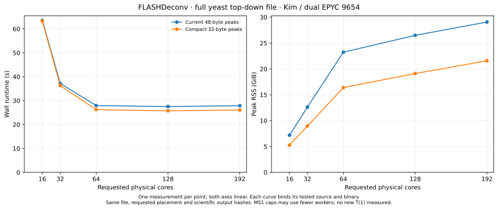
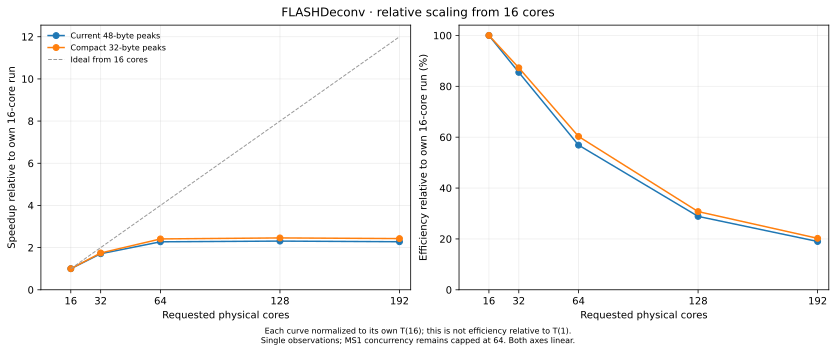

# Compact FLASHDeconv peaks: experimental branch

`codex/flashdeconv-compact-peaks` starts from the tested current implementation
(code `7d42c66d6e5cff8db76c2448ca9d7f65a61fac73`, documentation HEAD
`92c66f1f07c15cf791c020f90d4a92acef92449e`). This is a C++ source/API and ABI
experiment. Rebuild the library and every consuming application or Python module.
Do not combine old and new `LogMzPeak` objects or binaries.

The `LogMzPeak` facade owns its storage directly. It introduces no per-peak heap
allocation, pointer, virtual dispatch, arena lifetime or process-global state.

| Storage | Original | Experimental |
|---|---:|---:|
| `mz`, cached `logMz`, mass override | three doubles | three doubles |
| Intensity | float | float |
| Charge, polarity, isotope sign | int + bool | one `int16_t` flag word |
| Isotope magnitude | part of signed int | `uint16_t` |
| Expected stride on the tested 64-bit ABI | 48 B | 32 B |

The flag word uses eight charge bits, a polarity bit and an isotope-sign bit.
All stored word values are nonnegative and at most `0x3ff`, so they fit `int16_t`.
Independent polarity preserves negative-mode charge-zero peaks. An unsigned
magnitude plus sign preserves negative isotope indices, including the default
`-1`, while allowing the full positive `uint16_t` range. The facade returns a
signed `int` isotope value.

The experimental public domains are charge magnitude **0–200** and isotope
index **−65535–65535**. Checked setters reject other values before mutation.
The `min_charge` and `max_charge` parameters are checked before absolute-value
conversion and processing; this does not add validation to every pre-existing
manual-precursor or floating-to-integer conversion.
Candidate, harmonic and FDR section exceptions are collected and rethrown after
the respective OpenMP joins. These bounds deliberately restrict the former
public integer fields; this is not a compatible replacement for arbitrary old
custom inputs. Existing floating-to-int conversions elsewhere retain their
pre-existing finite/range assumptions.

C++ callers use `getMZ`/`setMZ`, `getIntensity`/`setIntensity`,
`getLogMz`/`setLogMz`, `getMass`/`setMass`, `getAbsCharge`/`setAbsCharge`,
`isPositive`/`setPositive` and `getIsotopeIndex`/`setIsotopeIndex`.
Python retains all seven writable attribute names through properties.
Changing mz does not recompute the independently writable logarithm or mass.
Charge zero still returns uncharged mass zero before consulting the mass
override. Floating precision, arithmetic order, comparison and hash keys remain
as in the reference implementation.

## Why the first experiment keeps mz and mass inline

M/z is used in hot matching and scoring loops and in detailed output. A side
table adds a dependent lookup. The mass override is normally zero in the main
production paths, but custom C++/Python peaks and writer tests use it, so removing
its semantics is unsafe.

Externalizing **mass alone** and adding a 32-bit side-table index leaves a
28-byte payload padded to **32 bytes** at double alignment: no peak-stride gain,
plus auxiliary storage and lookups. Moving **both mz and mass** could produce a
24-byte indexed representation, but needs stable identities, explicit lifetime
ownership and independent mutation/copy semantics. In an idealized design its
storage is `24 * copies + 16 * unique_payloads`, before ownership/reference
counts, allocator slack and table metadata. It beats 32-byte inline storage only
when payload sharing amortizes that extra storage. A global mutable registry
also introduces synchronization and reclamation costs; per-worker backing cannot
safely outlive worker reuse. A spectrum-owned immutable payload with separate
annotation handles is a possible later experiment, requiring changed container
and reference interfaces.

A 32-byte stride reduces the peak-vector payload by one third. This does **not**
mean RSS falls by one third or wall time improves by one third: other arrays,
reserved capacity, allocator retention and compute remain. Cache-miss and memory
bandwidth improvements require actual counters; they cannot be inferred from
structure size alone.

## Validation and measurements

The study uses one complete-file native measurement at each of
16/32/64/128/192 physical cores, matching the existing affinity, runtime libraries,
allocator environment and detailed-output options. The input is
`PXD059108/11112024_IntactYeastX0p166mg_3SecMS2_rep2_689.mzML`
(1,246,429,459 bytes; SHA-256
`4d5cb22bd51627ee613c2ee374d658b238aad7a08b0ff7916da3c01467f4ea09`).
It is the largest input used in this study, not a claim about the whole accession.

Both curves use the current 48-byte implementation with MS1 concurrency capped
at 64 (code `7d42c66d6e5cff8db76c2448ca9d7f65a61fac73`); only the experimental
curve includes the compact facade. This comparison isolates the representation
change from earlier FLASHDeconv improvements. It is not a comparison against the
original 2025 FVdeploy pin.

| Physical cores requested | 48 B wall (s) | 32 B wall (s) | Wall reduction | 48 B RSS (GiB) | 32 B RSS (GiB) | RSS reduction |
|---:|---:|---:|---:|---:|---:|---:|
| 16 | 63.560 | 63.308 | 0.40% | 7.188 | 5.277 | 26.59% |
| 32 | 37.177 | 36.268 | 2.44% | 12.627 | 8.957 | 29.07% |
| 64 | 27.940 | 26.256 | 6.03% | 23.241 | 16.399 | 29.44% |
| 128 | 27.535 | 25.747 | 6.49% | 26.493 | 19.114 | 27.85% |
| 192 | 27.897 | 26.080 | 6.51% | 29.066 | 21.574 | 25.77% |

The useful result is **26–29% lower RSS**, with observed wall reductions of about
6–6.5% at 64–192 cores. At 16 cores, the 0.4% runtime difference is too small to
interpret without variability measurements. All points are single observations,
run serially with the same input, physical-core prefixes and runtime policy;
there are no repetitions, confidence intervals or significance estimates.

Scaling still flattens beyond 64 cores: compact wall time changes from 26.256 s
at 64 to 25.747 s at 128 and 26.080 s at 192. The smaller representation reduces
memory pressure; it does not remove the remaining allocation work or sequential
phases. MS1 still uses at most 64 workers, while MS2 can use the full requested
team. Reported core counts therefore describe the requested physical placement,
not simultaneous useful occupancy throughout the process.

No new one-core run was requested. This figure uses `T(16)/T(N)` and
`100 * 16 * T(16)/(N * T(N))`; it is explicitly relative to 16 cores, not the
usual parallel efficiency based on `T(1)`.

## What the measurements support

The reference diagnostic observed one post-score candidate boundary with
388.637 MiB of nested vector capacity, of which 98.76% belonged to its two peak
vectors. The simultaneous first survivor copy added only 3.664 MiB there.
These are one worker/job boundary observations, not concurrent process totals;
maxima from different workers must not be summed into an RSS estimate. They
support prioritizing peak storage and candidate-buffer lifetimes over a global
pool for small metadata arrays.

At 64–192 cores the compact observations use about 5.6–5.7% less total charged CPU
and about 24–26% less system CPU. User CPU changes by about 1%. This is consistent
with reducing memory and kernel overhead, but it does not identify a particular
allocator lock, page-fault path or cache mechanism. Hardware cache-miss, bandwidth,
IPC and NUMA counters were unavailable. There is no measured cache-hit claim.
Detailed per-process CPU values are in the accompanying CSV.

The existing 64-core diagnostic located many sampled workers in heap-growth and
virtual-memory paths during MS1 renewal. The new 192-core diagnostic, with MS1
capped at 64 workers, still spends 16.940 s in MS1 with 223.621 system CPU seconds
and an average 59.09 charged cores. Its MS2 wave takes 1.550 s and has a 0.411 s
post-dispatch tail. These are separate instrumented observations, not timings to
combine with the native curves. They explain why compact storage helps without
restoring scaling to 192 cores. Larger scheduling chunks are not justified by
that tail; dispatching expensive MS2 spectra earlier is a separate experiment.

## Correctness, compatibility and review

All five compact native runs completed successfully. Each run produced the same
three complete positive scientific exports as the reference; all 15 files were
rehashed at cohort closure: 12,799 feature rows, 134,226 MS1 rows and 75,686 MS2
rows per run. Source, input, loaded runtime and physical-core placement checks
also closed successfully.

The build preprocessed all 760 actually linked library recipes, discovered 11
library consumers of the changed representation and freshly compiled 22 affected
translation units including clients/tests. Thirteen focused C++ tests passed.
Twenty-four small ordinary/FDR exports at 1/4 threads matched the reference;
some small exports are header-only, so the positive full-file checks matter.
A separate public C++ client passed 3,216 packed-state cases and 65,536 value,
copy and sort cases. The whole updated `bind_analysis.cpp` compiled; the exact
`LogMzPeak` binding block passed all 12 Python runtime tests. A full pyOpenMS
wheel and all-target OpenMS build were not performed. Rebuild every consumer
before using this changed ABI.

Claude Opus 5.5 and Kimi reviewed the source and design. Their concrete findings
led to corrected scalar access, checked narrowing, complete consumer discovery
and exception containment across OpenMP joins. Kimi's exact backing model was
not emitted. The [adversarial synthesis](FLASHDeconv-compact-peaks/adversarial-synthesis.md)
records adopted and declined recommendations; the reviews concern a draft,
while compiled/runtime evidence validates the corrected source.

The final branch has two whitespace-only changes after the immutable timed R2
snapshot (namespace alignment and hash-expression spacing). All tokens and line
counts are unchanged; the other 16 source files are byte-identical. A fresh
`FLASHHelperClasses_test` client then compiled against the final header and
passed the complete class test using the same tested compact library; see
[final-source-check.json](FLASHDeconv-compact-peaks/final-source-check.json). Source and
build identities, exact checks and scope are in
[validation-summary.json](FLASHDeconv-compact-peaks/validation-summary.json) and
[source-provenance.json](FLASHDeconv-compact-peaks/source-provenance.json).
The [native provenance](FLASHDeconv-compact-peaks/native-comparison-provenance.json)
and [data table](FLASHDeconv-compact-peaks/native-comparison.csv) bind the two
closed cohorts. The [auxiliary-storage analysis](FLASHDeconv-compact-peaks/auxiliary-storage.md)
explains the deferred 24-byte and owner-scoped alternatives. No renewal,
PeakGroup ownership-transfer or MS2 reordering experiment is bundled into this
compact measurement.
