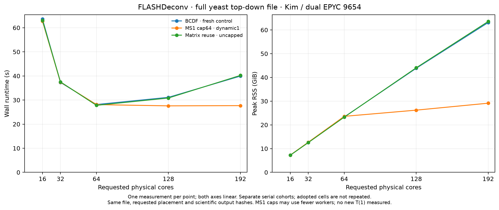
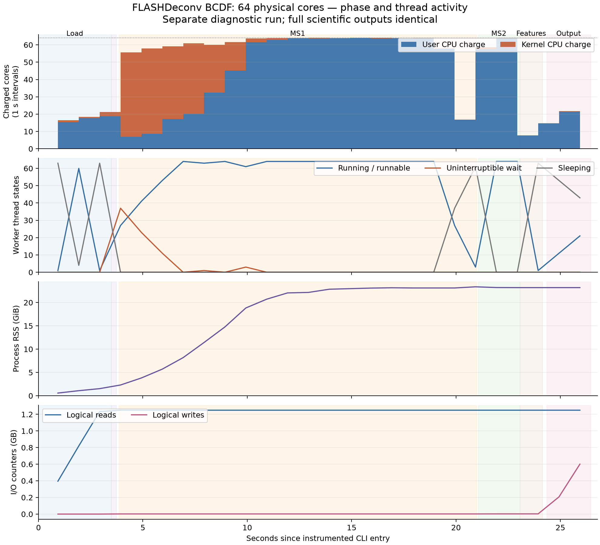

# FLASHDeconv: MS1 allocation overhead and high-core scaling

20 October 2026. Single measurements on Kim; complete process wall time and lifetime peak RSS.

**Select the MS1-only 64-worker cap and retain dynamic chunk one.** At 192 requested cores, complete wall time fell from 39.943 to 27.688 s (30.68% less; 1.443×), and peak RSS from 63.118 to 29.136 GiB (53.84% less). Bounded matrix reuse did not show a compelling benefit across its five-point grid; removing the eager noise reserve and increasing chunk size did not improve runtime. This is chiefly avoidance of a high-concurrency regression, not a demonstration that MS1 scales to 192 cores.

## Native measurements

| Requested cores | BCDF wall s | Cap64 wall s | Wall reduction % | BCDF RSS GiB | Cap64 RSS GiB |
| --- | ---: | ---: | ---: | ---: | ---: |
| 16 | 63.584 | 62.766 | 1.29 | 7.221 | 7.254 |
| 32 | 37.311 | 37.426 | -0.31 | 12.577 | 12.686 |
| 64 | 28.146 | 28.106 | 0.14 | 23.337 | 23.596 |
| 128 | 31.124 | 27.591 | 11.35 | 43.851 | 26.207 |
| 192 | 39.943 | 27.688 | 30.68 | 63.118 | 29.136 |

RSS is GiB (GNU time's KiB divided by 1,048,576). Percentages compare the same requested thread count with the fresh BCDF control. Differences around one percent are not established improvements: there is one run per condition, no variance estimate, and the host is shared. Cap64's 64/192 points come from the earlier screen in this study; its 16/32/128 points complete the curve using the identical source, executable, library, input, runtime and placement protocol. There are no repeated cells or interpolated measurements. The five-point curves start at 16 cores and do not establish a new one-core efficiency baseline.

The x-axis is requested physical cores. Cap64 intentionally uses at most 64 workers during MS1; it does not demonstrate MS1 scaling to 192 useful workers. At requested counts up to 64, the cap does not reduce the spectral team. The small differences there are observations from separate executions. MS2, loading and output retain their existing thread policies.

Comparing each version at its best measured count gives 28.146 s at 64 cores for BCDF versus 27.591 s at 128 requested cores for cap64: only 1.97% less wall time. That small cross-count difference lacks uncertainty estimates. The large same-count 192-core improvement should not be presented as a comparable gain over an already well-chosen 64-core baseline.

| Cores | BCDF user / system CPU s | Cap64 user / system CPU s | Charged cores BCDF / cap64 |
| --- | ---: | ---: | ---: |
| 16 | 900.82 / 15.07 | 897.91 / 13.01 | 14.40 / 14.51 |
| 32 | 927.93 / 47.83 | 926.13 / 47.97 | 26.15 / 26.03 |
| 64 | 983.04 / 248.28 | 982.72 / 244.03 | 43.75 / 43.65 |
| 128 | 1066.11 / 1375.43 | 1027.78 / 241.41 | 78.45 / 46.00 |
| 192 | 1150.55 / 3697.66 | 1074.59 / 249.00 | 121.38 / 47.80 |

Average charged cores = (user CPU seconds + system CPU seconds) / complete wall seconds. Kernel CPU is included, so higher charging can represent more overhead rather than more useful work. These totals are not phase occupancy measurements.

## Alternatives and selection

| Cores | Matrix reuse wall s | Matrix reuse RSS GiB | Wall reduction vs BCDF % |
| --- | ---: | ---: | ---: |
| 16 | 63.070 | 7.219 | 0.81 |
| 32 | 37.545 | 12.528 | -0.63 |
| 64 | 27.802 | 23.267 | 1.22 |
| 128 | 30.846 | 44.051 | 0.89 |
| 192 | 40.224 | 63.572 | -0.70 |

| Additional screen | Cores | Wall s | RSS GiB |
| --- | ---: | ---: | ---: |
| cap32 | 64 | 35.896 | 14.485 |
| cap32 | 192 | 35.756 | 19.805 |
| chunk16 | 64 | 35.816 | 18.867 |
| chunk4 | 64 | 31.279 | 22.698 |
| lazy-noise | 64 | 28.325 | 23.284 |
| lazy-noise | 192 | 41.373 | 62.626 |
| mc | 64 | 28.303 | 23.358 |
| mc | 192 | 27.536 | 29.152 |

**Bounded matrix reuse (M).** The implementation owns one scratch vector within the MS1 scoring call, confines it to the existing sequential candidate context, zeros every logical cell, preserves column-major indexing and arithmetic order, and retains at most 256 KiB of actual capacity. Oversize or ineligible work uses the fresh-storage path. No global pool, thread-local lifetime, mutex or persistent worker member was added. The largest measured logical matrix was 35,552 bytes, but MS1 constructed 64,278,583 of them, prescribing 34.128 GB of logical zeroing. This volume is not measured DRAM traffic. Reuse still requires the same logical zeroing.

Across 16/32/64/128/192 requested cores, observed wall differences stayed within about 1.3% of fresh BCDF; high-core RSS and system CPU growth remained. Frequency alone did not predict a useful end-to-end gain. The extra private overloads and scratch-lifetime rules are therefore kept as a tested alternative rather than added to the selected code. A composition with cap64, excluding N0, was also gated and screened: 64 cores: 28.303 s / 23.358 GiB; 192 cores: 27.536 s / 29.152 GiB. Relative to cap-only, its wall changes are +0.70% at 64 and -0.55% at 192. These small, mixed results do not justify the additional implementation; cap64 alone remains selected.

**Noise reserve removal (N0).** Removing one eager raw-noise reserve passed differential tests, including inputs with nonempty noise, but gave no observed native benefit: 28.325 s at 64 and 41.373 s at 192. Removing an allocation site need not reduce fragmentation, heap growth or contention in the remaining allocations. The result supersedes both external reviewers' favorable hypothesis. Scientific values and ordering matched the goldens; allocation/exception timing is not universally unchanged.

A second, separately perturbed syscall-count run of N0 at 64 cores counted **2,117,091 mprotect calls**, versus BCDF's 1,938,285: **9.225% more**, not the predicted decrease. This single traced observation does not estimate native syscall cost or variance. It leaves the exact sampled callsite assignment intact, but supplies no measured support for promoting N0.

**Larger chunks.** At 64 workers, MS1 dynamic chunks of four and sixteen took 31.279 and 35.816 s, versus fresh BCDF's 28.146 s with chunk one. Keep dynamic scheduling with chunk one. There are 2,019 MS1 jobs; chunk sixteen creates only 127 work units and would further constrain distribution at 192 workers. The experiment supports rejecting these two chunk sizes on this file, not a universal optimum for every dataset.

**Smaller cap.** Cap32 reduced RSS further but took 35.896 s at requested 64 and 35.756 s at requested 192. It is a memory/runtime tradeoff, not the fastest tested choice. Cap64 gives the better runtime balance on this machine and file. A fixed threshold is workload and hardware dependent; cross-dataset validation remains necessary before generalizing the policy.

## What the 64 workers are doing

A separate, full-output-equivalent BCDF diagnostic run measured the phases below. Native timing, phase instrumentation, debugger stops, syscall tracing and source counters are separate experiments. Their wall times and CPU fractions must not be combined. Enclosing timers and their children must not be added.

| Phase | Wall s | User CPU s | System CPU s | Average charged cores |
|---|---:|---:|---:|---:|
| Load | 3.483 | 50.264 | 2.923 | 15.27 |
| Filter and compact | 0.240 | 10.807 | 0.317 | 46.38 |
| Averagine initialization | 0.057 | 1.883 | 0.001 | 33.15 |
| Worker setup | 0.004 | 0.003 | <0.001 | 1.00 |
| MS1 spectral wave | 17.140 | 779.142 | 231.852 | 58.99 |
| Precursor handling | 0.069 | 1.348 | 0.744 | 30.12 |
| MS2 spectral wave | 1.982 | 126.255 | 0.543 | 63.97 |
| Feature processing | 1.070 | 0.993 | 0.076 | 1.00 |
| Q-values | 0.105 | 0.105 | <0.001 | 1.00 |
| Spectrum output | 2.108 | 49.801 | 0.617 | 23.92 |

The [per-worker state heatmap](FLASHDeconv-ms1-20261020/thread-states64.png) shows the sampled 64-worker histories individually.

The occupancy figure uses interval CPU charging and sampled thread states, not instruction-level utilization. R means running **or runnable**. D-state does not establish disk waiting. The first CPU interval is unavailable and is left blank. The 1 Hz observer ran on a spare physical core, verified the process identity, and avoided memory-map readers that could themselves create mapping-lock contention.

**Early MS1:** kernel work and allocation-related blocking rise while RSS grows. One sample found 37 of 64 workers in D-state: 20 in `do_mprotect_pkey`, 16 in `__vm_munmap`, and one in `lock_mm_and_find_vma`. A separate debugger stop caught 35 workers in `mprotect <- grow_heap <- sysmalloc <- operator new <- PeakGroup`.

**Later MS1:** most sampled workers are running/runnable, with little further kernel accumulation. Jobs are heterogeneous: individual workers receive 13–64 spectra, and one observed job lasts 6.076 s, including any blocked/preempted intervals. The interval from each worker's recorded loop arrival to the final worker's arrival totals 56.323 core-seconds, 5.135% of the region's capacity, with a 1.333 s arrival spread. This is an arrival tail, not a pure barrier-call duration. The 7.834% complement of process CPU charging is a different quantity and cannot all be assigned to that tail.

**MS2 and later:** MS2 charges almost the full 64-core team, with negligible kernel CPU relative to MS1. Feature processing and Q-values are sequential but total only about 1.17 s in this diagnostic. Spectrum output has partial process CPU charging, about 24 cores; this table-linked number covers the whole output span rather than formatting alone. Format and ordered-commit microspans are recorded, but they are too short for reliable process-CPU attribution.

## Where contention comes from

All 35 sampled heap-growth stacks were resolved against the protected native ELF. Fourteen callsites are the eager raw-noise reserve in recruitment; sixteen are signal `push_back`, and five signal `reserve`, all during scoring-time renewal. Saved return-PC resolution identifies the specific raw reserve separately from the filtered-output reserve. These are sampled contexts, not percentages of runtime or a census of every allocation.

The source supports a shared virtual-memory mechanism. Glibc 2.39's heap growth invokes `mprotect` to extend protected heap space; Linux v6.8's corresponding path takes the process memory-map write lock. Separate worker arenas can therefore encounter process-wide mapping serialization. This supports the observed call chains, without measuring lock-hold time or attributing all kernel CPU to that lock. [glibc arena implementation](https://github.com/bminor/glibc/blob/glibc-2.39/malloc/arena.c), [Linux memory-protection implementation](https://github.com/torvalds/linux/blob/v6.8/mm/mprotect.c).

A separate traced BCDF64 run counted 1,938,285 `mprotect` calls, versus 2,098 `mmap`, 1,385 `munmap`, 2,930 `brk` and 165 `madvise` calls. Its elapsed time was substantially perturbed. Summed syscall elapsed times overlap across threads and are not native wall-time fractions. Its `futex` count cannot be assigned wholly to OpenMP scheduling: the saved non-worker background thread also has condition-variable waits. At both later debugger stops, `mprotect`/`grow_heap` stacks were absent; allocation itself continued. The final stop showed eleven OpenMP waits and 53 other worker contexts.

A separate 192-requested-core diagnostic verified the realized spectral teams and placement against the frozen protocol: **64 MS1 workers and 192 MS2 workers**, with all 2,019/11,166 jobs covered and all three full scientific export goldens preserved. This confirms the intended phase policy. MS1 charged 59.22 cores on average; MS2 charged 142.32 of its 192 available cores. MS2's recorded arrival tail occupied 25.06% of region capacity, with a 0.426 s arrival spread, versus MS1's 5.34% tail. These are measured arrival tails, not exact scheduler waiting durations. The lifetime RSS high-water mark increased by 5.742 GiB between precursor-end and MS2-end records; this brackets when the new peak appeared without assigning ownership or measuring current live RSS. Its instrumented wall time is excluded from the native curve.

**I/O:** 18 process samples spanning 17 seconds inside MS1 had unchanged logical read/write counters and I/O syscall counters. The warm run's sampled storage-read bytes were zero. A separate tmpfs-output execution took 27.732 s versus the earlier native64 execution's 28.104 s; this unreplicated, asynchronous comparison does not establish a precise I/O gain. Together the evidence argues against disk I/O as the main MS1-interior bottleneck under this warm-input protocol. It does not claim that cold loading, other storage systems or final output are free.

**Cache and scheduling:** hardware cache misses, bandwidth, IPC and scheduler run-queue waiting times were unavailable under the host's current profiling permissions. Context switches and runnable-state samples are not substitutes. The evidence supports allocation/mapping contention much more directly than false sharing or a dispatcher bottleneck. Larger chunks actually regressed. No cache-hit improvement is claimed without counters.

## Memory layout and the next useful experiments

Actual matched layout probes give `PeakGroup` 296 bytes, `SpectralDeconvolution` 2,520 bytes and `DeconvolvedSpectrum` 1,376 bytes, aligned to eight. Even 192 inline worker shells total only 0.461 MiB; dynamically owned storage, live candidate payloads, retained capacities and allocator state matter far more. Selected per-worker stage-capacity maxima are 14.0 MiB for candidate arrays, 24.9 MiB for filter arrays and 17.9 MiB for extraction arrays. These are incomplete, non-simultaneous ledgers and must not be summed into an invented RSS estimate.

MS1 presents 25,084,443 candidate PG objects to scoring across 2,019 spectra; per-worker maximum per-spectrum counts range from 34,466 to 36,840. Each PG has multiple owned vectors. Actual simultaneous signal capacities are missing from the ledger, so multiplying candidate counts by a guessed reserve would be unjustified. MS2 capacity maxima also include buffers retained from earlier MS1 work and do not prove an intrinsically equal MS2 workload. All measured noise-power calls returned on empty input; the noise graph executed zero times, so pooling graph storage has no demonstrated benefit here.

The next priority is measuring coexisting signal-vector size/capacity during renewal and survivor publication, then testing bounded renewal storage or earlier release of failed candidates after verifying their last readers. Blindly retaining every PG's high-water capacity could increase RSS. A global shared pool would also introduce handoff and synchronization costs; bounded local ownership is the simpler first experiment. Per-NUMA pooling is a hypothesis for a measured ownership problem, not a demonstrated fix. Streaming load/preprocess and more feature/output parallelism remain later architectural work, with precursor dependencies and deterministic output ordering preserved.

## Reproducibility and review

- **Reference:** the prior selected BCDF implementation at research commit `d07664d8431ebf1c2d9deb86d0ebc298108718f7`, derived from PR revision `873810d89d2f957be2584667f075c8efa228a06e`. This report's baseline is that current-develop-derived implementation, **not** the Methods' original FVdeploy pin.
- **Host:** Kim, two AMD EPYC 9654 sockets, 192 physical cores/384 logical CPUs; 24 eight-core LLC groups. Every measurement uses a nested, socket-round-robin, LLC-striped physical-core prefix with no SMT siblings. `OMP_PROC_BIND=close` refers to those custom places, not natural contiguous core numbering.
- **Build/runtime:** GCC 14.4, C++23, Release/O3, `-ffp-contract=off`; unchanged third-party/runtime closure; BLAS threads one; OpenMP dynamic off, maximum active levels one; unchanged allocator and wait-policy environment. Builds/tests ran separately on node06. Native cells and diagnostic jobs were serialized under a shared Kim lock.
- **Input:** [ProteomeExchange PXD059108](https://proteomecentral.proteomexchange.org/cgi/GetDataset?ID=PXD059108), `11112024_IntactYeastX0p166mg_3SecMS2_rep2_689.mzML`, 1,246,429,459 bytes, SHA-256 `4d5cb22bd51627ee613c2ee374d658b238aad7a08b0ff7916da3c01467f4ea09`. 13,185 spectra: 2,019 MS1 and 11,166 MS2; 90,546,658 raw points. This is the largest tested input, not a claim about the accession's largest file.
- **Work:** complete `FLASHDeconv` invocation with `-write_detail`, feature output and both spectral outputs, default no-FDR/no-merging behavior, precursor window one. Input was reread before timing. Wall time includes process startup/teardown and output; golden rehashes and resource checks happen outside it. Native runs do not use `-test`.
- **Correctness:** each candidate passed 13 focused unit/integration tests and 24 small differential exports across baseline/new, 1/4 threads and FDR off/on. M rebuilt all 19 header consumers, preserved layouts, and passed 21 focused boundary/differential cases with 1/4 independent owners; N0 passed 32 public differential cases at both owner counts. Every reported full-file cell passed all three complete export byte hashes and positive row counts: 12,799 features, 134,226 MS1 masses, 75,686 MS2 masses. Diagnostic results have the same gate but are excluded from native scaling curves.
- **Reviews:** actual Claude Opus 5.5 and Kimi source-only reviews informed the design and recruitment analysis. Kimi's exact backing model was not emitted by its CLI. Their recommendations were reconciled adversarially against source, instrumentation and measured outcomes. No model prediction is presented as a benchmark.

The selected source is committed locally as `7d42c66d6e5cff8db76c2448ca9d7f65a61fac73` on `codex/flashdeconv-scaling16`, with the exact tested cap64 source and regression-test hashes. This study does not include a new Windows build. [All native measurements](FLASHDeconv-ms1-20261020/measurements-all.csv), [plot adoption and source checks](FLASHDeconv-ms1-20261020/native-comparison-provenance.json), [phase data](FLASHDeconv-ms1-20261020/phase-events.csv), [exact sampled allocation-site proof](FLASHDeconv-ms1-20261020/exact-allocation-callsite-proof.json), and [source-bound provenance](FLASHDeconv-ms1-20261020/provenance.json) accompany the report. Durable producer evidence is under `/ceph/ibmi/abi/oliver/flashdeconv-performance-20261006/ms1-20261020`; compact local captures are retained in the study workspace. Large inputs, ELF files and scientific exports were hashed by the remote producers; compact evidence was independently replayed locally.
