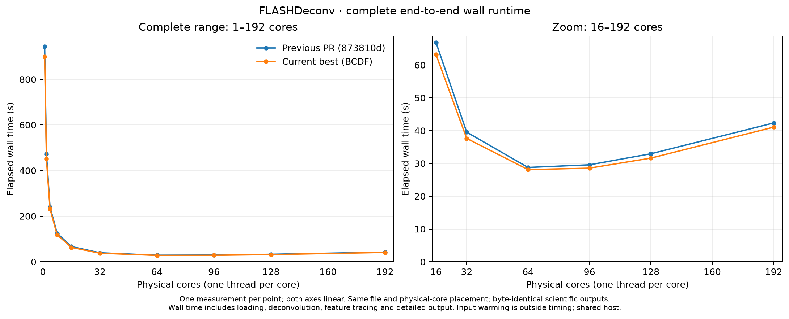
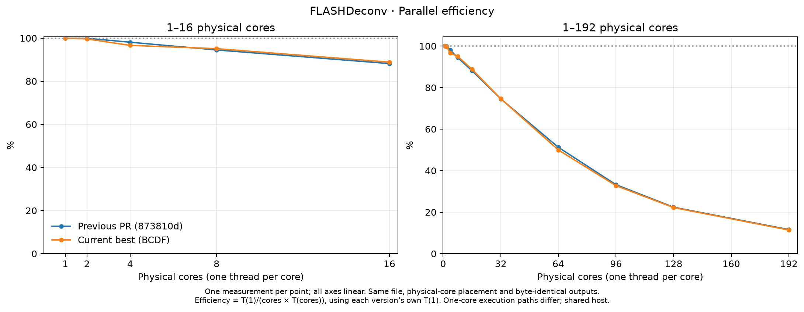
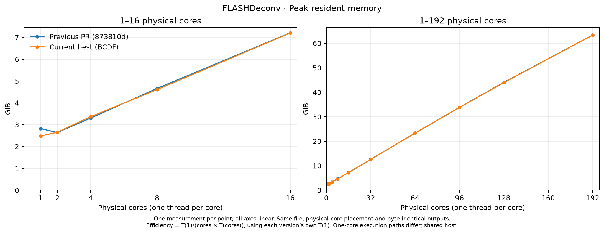
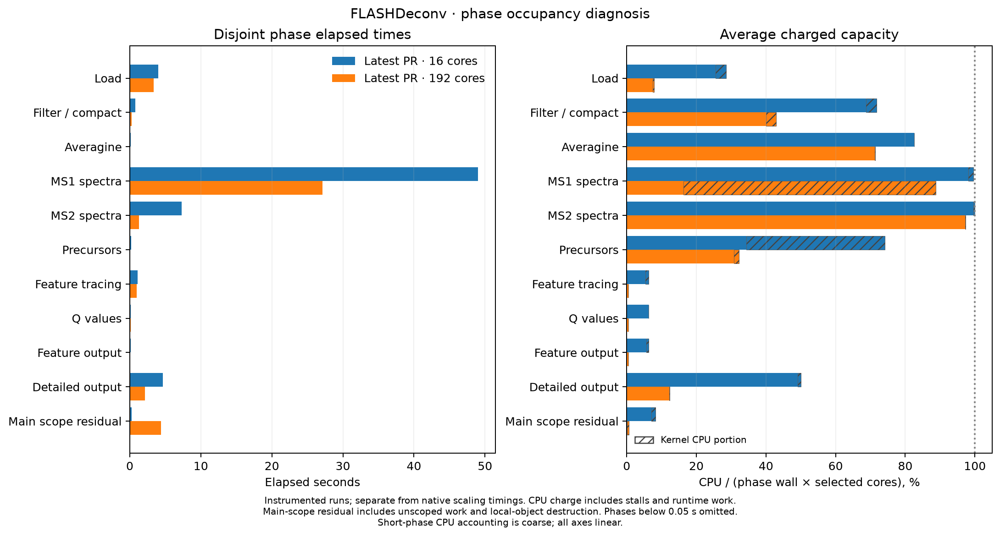
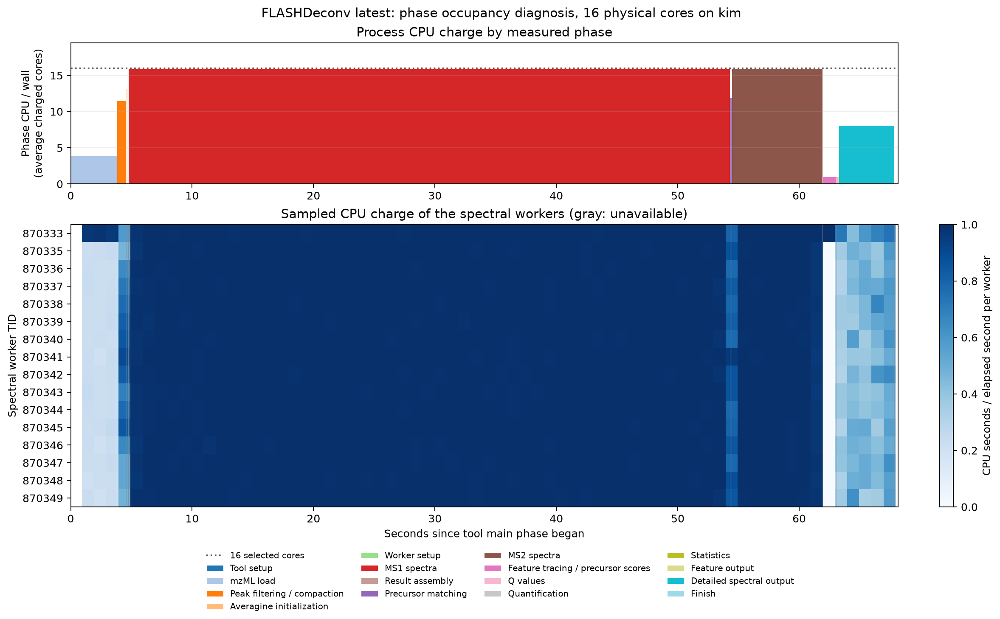

# FLASHDeconv: native scaling and MS1 bottlenecks

20 October 2026. The comparison is the previous published PR revision `873810d` against the tested **BCDF** candidate built from it. All 20 native cells completed, covering **1, 2, 4, 8, 16, 32, 64, 96, 128 and 192 physical cores**. Each cell is one measurement. All 60 complete scientific exports match byte for byte.

BCDF takes **63.20 s at 16 cores** versus 66.85 s for the previous version (+5.46% elapsed reduction). Its fastest measured point is **64 cores, 28.10 s**. At 192 cores it takes 41.05 s versus 42.32 s (+3.00% elapsed reduction). BCDF was selected as the integrated candidate before this full grid; it is not a per-count envelope of whichever trial happened to run fastest. The MS1 localization below comes from matched diagnostics of `873810d`; BCDF's native grid establishes total time and memory without a separate phase attribution. Small differences have no replication-based uncertainty estimate.

Peak RSS still grows from 23.339 GiB at 64 cores to 63.344 GiB at 192. BCDF's native 192-core run spends 3,759.82 of 4,913.45 CPU-s in the kernel (76.5%). The changes improve runtime without resolving that high-core resource amplification.

## Complete wall runtime



The left panel contains every point; the right panel expands 16–192 cores while retaining linear axes. These are complete process wall times, including loading, spectral work, feature tracing, detailed output and normal cleanup. Input warming, hashing and validation happen outside timing.

| Physical cores | Previous wall s | BCDF wall s | Elapsed reduction % | Previous / BCDF efficiency % | Previous / BCDF RSS GiB |
|---:|---:|---:|---:|---:|---:|
| 1 | 943.400 | 898.539 | +4.76 | 100.00 / 100.00 | 2.824 / 2.484 |
| 2 | 471.982 | 450.898 | +4.47 | 99.94 / 99.64 | 2.645 / 2.657 |
| 4 | 240.408 | 232.460 | +3.31 | 98.10 / 96.63 | 3.302 / 3.368 |
| 8 | 124.772 | 118.081 | +5.36 | 94.51 / 95.12 | 4.664 / 4.609 |
| 16 | 66.854 | 63.203 | +5.46 | 88.20 / 88.85 | 7.209 / 7.201 |
| 32 | 39.523 | 37.622 | +4.81 | 74.59 / 74.64 | 12.620 / 12.598 |
| 64 | 28.772 | 28.104 | +2.32 | 51.23 / 49.96 | 23.323 / 23.339 |
| 96 | 29.572 | 28.561 | +3.42 | 33.23 / 32.77 | 33.827 / 33.832 |
| 128 | 32.939 | 31.616 | +4.02 | 22.38 / 22.20 | 44.062 / 43.947 |
| 192 | 42.322 | 41.052 | +3.00 | 11.61 / 11.40 | 63.336 / 63.344 |

Positive elapsed reduction means a shorter runtime; negative means a slower run. Efficiency uses each version's own one-core time. BCDF's one-core path and memory differ, so a lower efficiency percentage can coexist with a faster absolute runtime. [All counters and computed metrics](FLASHDeconv-scaling-20261020/measurements.csv) include user/kernel CPU, page faults and context switches.





## Dataset, build and placement

The input is the complete centroided yeast file **11112024_IntactYeastX0p166mg_3SecMS2_rep2_689.mzML**, from [PXD059108](https://proteomecentral.proteomexchange.org/cgi/GetDataset?ID=PXD059108): 1,246,429,459 bytes, 13,185 spectra (2,019 MS1; 11,166 MS2), and 90,546,658 raw peak-array points. This is the largest input tested, not the largest file in the accession. SHA256: `4d5cb22bd51627ee613c2ee374d658b238aad7a08b0ff7916da3c01467f4ea09`.

Timings run serially on **Kim, dual AMD EPYC 9654**, with 192 physical cores and 384 logical CPUs, two NUMA nodes and 24 last-level cache groups. Nested fixed placements distribute cores across sockets/cache groups and use one SMT representative per physical core. OpenMP uses singleton places, `OMP_PROC_BIND=close`, `OMP_DYNAMIC=FALSE`, `OMP_MAX_ACTIVE_LEVELS=1`; BLAS pools use one thread. Wait/spin overrides and allocator overrides are unset in both plotted series.

Both versions use the same GCC 14.4 / C++23 Release configuration (`-O3 -DNDEBUG`, OpenMP), unchanged CLI executable and OpenSwath library. Only the measured OpenMS library differs; the actual resolved non-OpenMS dependencies match. BCDF was built incrementally on node06 with changed code and key header consumers recompiled and the focused checks run; this is not a fresh whole-project build. Timing and primary diagnostics use Kim; earlier node06 diagnostics are not pooled into these numbers.

```bash
FLASHDeconv -in INPUT.mzML -threads P -no_progress -keep_empty_out \
  -out features.tsv -out_spec1 ms1.tsv -out_spec2 ms2.tsv -write_detail
```

Algorithm defaults retain precursor window 1, no merging and no FDR. Every run produces 12,799 feature rows, 134,226 MS1 rows and 75,686 MS2 rows. Tested output parity preserves the inherited frame-ID fallback and previously documented noise-classification limitation; it does not establish biological accuracy. Source, library, input, runtime and export hashes are recorded in [compact provenance](FLASHDeconv-scaling-20261020/provenance.json).

## Why scaling falls beyond 64 cores

The latest published PR control, `873810d`, is efficient through 16 cores: 943.40 s at one core becomes 66.85 s at 16, or 14.11× speedup and 88.20% end-to-end parallel efficiency. Its fastest measured point is 64 cores at 28.77 s. At 192 cores it takes 42.32 s, consumes 5,024.66 CPU-s and reaches 63.34 GiB peak RSS. Kernel CPU grows from 15.31 s at 16 cores to 3,835.68 s at 192. This is a work-efficiency problem as well as a partially parallel stage problem.

From 64 to 192 cores, kernel CPU accounts for 95.2% of the additional total CPU charge. This makes the MS1 kernel cost the first investigation priority.

| Previous PR cores | Total CPU s | Kernel CPU s | Mean charged cores | Voluntary switches | Minor faults |
|---:|---:|---:|---:|---:|---:|
| 16 | 946.09 | 15.31 | 14.15 | 33,054 | 4,240,764 |
| 64 | 1,240.66 | 232.59 | 43.12 | 249,016 | 8,115,404 |
| 128 | 2,507.49 | 1,403.78 | 76.12 | 543,613 | 13,846,313 |
| 192 | 5,024.66 | 3,835.68 | 118.72 | 925,455 | 19,189,160 |

Voluntary context switches and minor faults rise sharply, but their counts do not identify which operation waited, its duration, or how many unique pages were touched. At 192 cores, mean charged capacity is about 61.8% over the full process, while end-to-end scaling efficiency is only 11.6%. CPU activity and parallel efficiency measure different things.

Private diagnostics at 16 and 192 cores use the same instrumented executable and library. They reproduce the same 2,019 MS1 and 11,166 MS2 jobs, filtered raw-point totals, candidate totals (25,084,443 / 8,632,580), and final mass-row totals. The increased CPU charge is not explained by additional measured candidates. Diagnostic timings below remain separate from native timings.

| Diagnostic phase | 16-core wall s | 192-core wall s | 16-core kernel CPU s | 192-core kernel CPU s |
|---|---:|---:|---:|---:|
| Loading | 3.988 | 3.379 | 1.952 | 2.614 |
| MS1 spectral wave | 48.998 | 27.126 | 11.100 | 3,778.812 |
| MS2 spectral wave | 7.322 | 1.290 | 0.541 | 0.376 |
| Feature tracing | 1.120 | 0.999 | 0.158 | 0.000 |
| Detailed output | 4.640 | 2.153 | 0.732 | 0.803 |

The main-scope residual grows from 0.264 s / 0.350 CPU-s at 16 to 4.412 s / 4.748 CPU-s at 192. Almost all its wall interval is after the finish timer closes and before the total timer closes. The C++ declaration/destruction order places local experiment, result and algorithm-object cleanup there; the residual also includes small unscoped gaps and instrumentation work. This is approximately a one-core cost, with no measured allocation-owner split. Bounded parallel release after all outputs could be tested, but freeing many buffers together could increase kernel cost.



The phase comparison covers the instrumented `cli.total` / `main_` scope. Complete process wall time also includes about 2.14 s outside that scope in the 192-core diagnostic (0.87 s at 16). That difference can include outer runtime work and diagnostic serialization; it has no measured allocation-owner attribution and is not assigned wholly to production cleanup.

MS1 accounts for almost all kernel CPU at 192 cores. Its job scopes contain 4,623.57 CPU-s, versus only 0.051 CPU-s outside jobs and 1.127 CPU-s in the measured end barrier. The observed arrival tail is 4.32% of wave capacity; at 16 cores it is 0.25%. Better final-job ordering cannot explain or remove the dominant increase in CPU inside jobs. The recorded runtime reuses worker identities across phases at 16 cores; there is no evidence of an OS thread being created for every spectrum.

At 192 cores the MS1 phase averages 88.8% charged capacity, but about 72.6 percentage points are kernel CPU and only 16.2 are user CPU. High occupancy therefore does not imply productive computation. At 16 cores, approximately 80% of spectral job CPU is in the inclusive score/filter region. At 192, extraction plus scoring/filtering account for about 98% of MS1 job CPU; their CPU charges grow roughly 13.6× and 5.3× respectively. Candidate-bin construction and dense filtering together account for under 2% there. Inner timers do not separate user from kernel CPU, so they cannot identify a particular syscall or lock.

Repeated allocation, touching and disposal of peak-group storage is a source-supported hypothesis. Cache pressure, frequency changes and memory placement can also raise user CPU cost. No cache-miss, IPC, bandwidth, kernel-stack or allocation-ownership census was obtained. The measurements localize the problem to MS1 work; they do not prove a specific VM lock, allocator backend, NUMA migration or false-sharing mechanism.

## Changes implemented and tested

The combined candidate, **BCDF**, contains four changes:

| Component | Change | Scope |
|---|---|---|
| B | Store admitted candidate-bin support and previous charge in two bytes | Maximum charge 0–253; existing wider fallbacks remain |
| C | Enable the existing outer spectral path with one worker | Avoids some copied handoffs; precursor registration still has a separate one-thread path |
| D | Borrow immutable cached isotope distributions in two scoring callers | Public value-return semantics remain unchanged |
| F | Increase detailed-output batches to up to 16 jobs per worker, capped at 256 strings | Same cap as latest at 64 writer workers and above |

There is no new thread pool or global hot-path lock. Writer commits retain spectrum order; the algorithm's scan-order behavior matches in the tested cases. The candidate passes 13 focused checks and 24 small output comparisons, including detailed/plain/FDR output and failed-stream handling. The writer regression crosses a full 64-job batch and a three-job tail. The compact-state model also passed 97,728 boundary comparisons, and the isotope-cache test checks public copy independence and mass-bin boundaries. These are targeted Linux checks, not a full OpenMS rebuild or Windows runtime certification.

C's separate one-core screen used 12.15% less peak RSS, with 0.79% less elapsed time. The subpercent timing difference is not established as reproducible. C changes progress/error publication to the existing after-join behavior and may allocate an unused worker for a level with only one job. OpenMP 2 retains its older handling of inactive one-thread regions. These tradeoffs are retained in the review evidence.

## Alternative screens and detailed output

All screens use one measurement; small differences have no noise estimate.

| Trial | Threads | Wall s | CPU s | Peak RSS GiB |
|---|---:|---:|---:|---:|
| Latest PR, spread placement | 16 | 66.854 | 946.09 | 7.209 |
| A: borrow feature-trace object | 16 | 66.997 | 953.06 | 7.208 |
| B: compact candidate state | 16 | 66.514 | 940.31 | 7.193 |
| D: borrow isotope cache | 16 | 66.151 | 933.10 | 7.155 |
| E: defer single-charge temporaries | 16 | 67.262 | 951.22 | 7.210 |
| F: larger writer batches | 16 | 64.819 | 935.65 | 7.244 |
| Passive OpenMP waiting | 16 | 69.404 | 938.41 | 7.289 |
| Latest PR, packed placement | 16 | 70.429 | 1,005.59 | 7.291 |
| B, packed placement | 16 | 69.434 | 984.54 | 7.222 |

A and E were excluded from the combination. Passive waiting reduced CPU charge slightly but increased wall time. Packed placement used eight physical cores sharing one LLC on each socket, versus the spread trial's 16 distinct LLC groups. Its slowdown and CPU increase show placement sensitivity; they are not direct cache-miss measurements, and frequency was not controlled.

The writer diagnosis supports the batching hypothesis and F's observed benefit at moderate counts. MS1 spectra are only 14.19% of formatting jobs but consume 85.04% of timed job CPU: 10.88 ms per job versus 0.317 ms for MS2. At 16 cores, larger batches reduce the observed wave count from 179 to 45, raise timed-job charged capacity from 32.14% to 69.37%, and reduce the writer phase from 4.640 to 2.355 s. Total writer CPU falls from 37.19 to 24.89 s. The whole instrumented F run was slightly slower because other phases differed between runs; this is not substituted for the native F timing.

CPU outside timed formatting jobs includes joins, commits, runtime work and diagnostic aggregation. It is not a direct spinning measurement. Sequential wall/thread-CPU clock reads produced small positive CPU-over-wall differences, at most about 12 microseconds per worker aggregate; these are retained, not clipped. Short process-CPU intervals likewise cannot provide exact instantaneous occupancy.

## Memory, allocation policy and cache layout

Peak RSS rises by about 0.33 GiB per added worker over the parallel 2–16-core points. Measured dense scratch envelopes reach only about 25 MiB for one worker's filtering stage. Separate candidate/filter/extraction maxima occur at different times and must not be added. They do not explain the full RSS slope: candidate and survivor peak-group payloads, copies, input/results and allocator retention are incompletely counted.

Modern `Matrix<int>` is backed by a vector: fresh resizing initializes every coefficient. Updating selected columns later does not make its initial allocation sparse. The immutable averagine is already shared without a per-query reference-count increment. A `jemalloc_bg_thd` name does not establish which allocator serves ordinary C++ vectors.

One separate native 192-core probe set `MALLOC_MMAP_MAX_=0` and `MALLOC_TRIM_THRESHOLD_=1073741824`, leaving code, OpenMP policy and placement unchanged. These are process-local controls for glibc allocation policy ([GNU documentation](https://sourceware.org/glibc/manual/latest/html_node/Memory-Allocation-Tunables.html)). Wall time was 38.642 s, kernel CPU 3,397.94 s, and peak RSS 63.573 GiB: observed changes of −8.70%, −11.41%, and +0.37% from default 192. It still spent 74% of CPU in the kernel and remained slower than default 64 cores. The unreplicated response supports allocation-policy sensitivity; it does not prove the provider or exact mechanism. It has no separate one-core timing and is excluded from the efficiency curves and production defaults.

At 16 spread cores, each selected worker has a distinct LLC group; at 192, eight workers share each of 24 groups. The immutable and mutable working sets therefore face different cache conditions as the count grows. Actual cache misses and traffic remain unmeasured.

A reusable pool should have one run owner, a bounded total capacity and worker-local leases, preferably grouped by NUMA node and first-touched by the consuming worker. This can avoid repeated allocation without putting a mutex in inner loops. It cannot eliminate storage required by all simultaneously active workers. Pooling every retained peak-group buffer without an ownership census could increase RSS, spread large capacities across workers and worsen cache use. That broader pool is a proposed next implementation, not a claimed result of BCDF. The two-knob allocator trial does not bound the benefit of eliminating allocations or copying.

## Priorities supported by these results

1. **Measure and reduce MS1 storage churn inside extraction and scoring.** Add current RSS and simultaneous ownership/capacity counters, then test bounded scratch and peak-group reuse. Obtain syscall or call-path evidence before assigning the kernel cost to a particular lock or allocator operation. Preserve a low-retention fallback for unusual spectra.
2. **Test a separate MS1 concurrency budget.** The observed optimum at 64 and the MS1-specific kernel amplification justify a trial that limits simultaneous heavy MS1 jobs while retaining larger teams for MS2. This trades peak concurrency for less storage pressure; it requires actual team/RSS measurements. Pair it with an audit of peak-group payloads and copies before attempting a larger layout change.
3. **Keep the writer's work mix balanced with a byte budget.** The current cap is a number of strings, not bytes. Larger batches help at 16; simply requesting more than 64 writer threads does not address heterogeneous jobs or memory pressure.
4. **Pipeline loading, preprocessing and early MS1 work with bounded queues.** This must preserve metadata, precursor dependencies (including lookahead), output order and guarded FDR/merging paths. The present implementation still loads the full experiment and runs MS-level waves; streaming is not implemented here.
5. **Treat final-tail scheduling as secondary.** A cost-descending MS1 permutation is feasible while keeping original result/error slots, but starting the largest jobs together may increase memory. The measured 192-core tail is much smaller than the in-job kernel cost, so this trial was deferred.

## Validation, reviews and limits

Each native cell is one measurement by request. Inputs are warmed outside timing; parsing, decoding and detailed scientific output remain inside. The two versions were timed in separate serial cohorts, without randomized paired alternation. The host is shared, clocks/frequency were not normalized, and sibling activity can affect results. Before/after resource snapshots and the high-core run guards found no configured quota limit; they are not whole-node exclusivity guarantees. The machine has 192 physical cores and 384 logical CPUs; the measured grid uses one logical CPU per selected physical core and stops at 192.

Efficiency is `T(1)/(p*T(p))`, using each version's own one-core timing. The one-core and multiworker execution paths differ, even with C's partial unification; effective Karp–Flatt values are descriptive overhead measures, not literal measured serial fractions. RSS is GNU time's process-lifetime maximum, not a phase-local peak. CPU charge includes stalls and runtime work.

Actual Kimi and Claude reviews informed the alternatives and challenged the analysis. Claude returned Opus 5.5; Kimi's CLI did not expose an exact model identifier. Reconciliation rejected a supposed shared-apex race (the index is local), exact spin-time deductions from coarse CPU accounting, allocator identification from a thread name, and cache-causality claims without counters. Review rankings were treated as hypotheses and checked against source and measurements. See the provenance file for exact source, build, input, export and review-receipt identities.

The original FVdeploy/develop baseline comparisons remain in [the earlier report](FLASHDeconv.md). They are historical measurements and are not pooled with this study's latest-PR-versus-BCDF curves. Profiling changes are private to the experiment and are not included in the production candidate.

## Sampled core activity



This separate instrumented 16-core run sampled worker activity once per second on a spare physical core. It shows worker identities across phases and uneven utilization in loading, feature tracing and detailed output. A busy sample includes stalls, runtime and kernel activity. The matched 192-core diagnostic has phase/job timers but no external sampler occupying another physical core; its aggregate charged-capacity comparison appears above.

## Evidence and reproduction

The durable study root is `/ceph/ibmi/abi/oliver/flashdeconv-performance-20261006/scaling16-20261020`. Native journals are `latest-native-r1`, `latest-high-native-r1` and `selected-native-r2`; joined previous-version journals contain nonoverlapping counts with identical executable/runtime/input identities. Source and runtime hashes were checked before and after each closed cohort. Complete TSVs and ELF files remain on HPC; the report bundle contains compact measurements, identities and plots.

The production candidate contains no diagnostic timers. Private phase/job instrumentation and native alternatives have separate source/library identities. [Six-panel scaling/counter overview](FLASHDeconv-scaling-20261020/native-scaling.svg), [vector wall plot](FLASHDeconv-scaling-20261020/wall-runtime.svg), [measurement CSV](FLASHDeconv-scaling-20261020/measurements.csv), and [provenance](FLASHDeconv-scaling-20261020/provenance.json) accompany this report. Three actual review rounds each from Claude Opus 5.5 and Kimi, and independent source/measurement audits, are identified in provenance; model suggestions are hypotheses, not extra benchmark runs.
