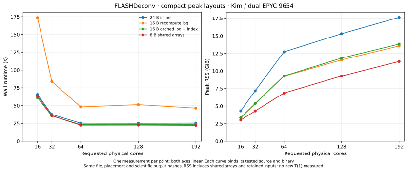
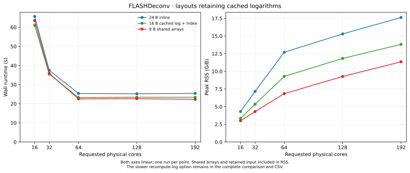
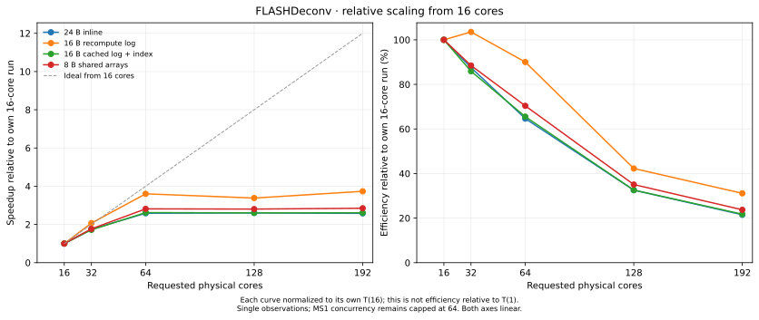

# FLASHDeconv shared-array peak experiment, 2026-10-21

The 8-byte shared-array candidate reduces observed 64-core full-process wall time
from **25.391 to 22.568 s (11.12%)** and peak RSS from **12.709 to 6.849 GiB
(46.11%)**, relative to the freshly measured mass-free 24-byte implementation.
It uses less RSS at every measured count. The cached 16-byte option is faster at
16 and 32 cores; the shared-array option is faster at 64–192 cores in these
single observations. Recomputing logarithms saves memory but loses substantially
on runtime. These measurements do not establish statistical significance.

## Implementations and ownership

All candidates derive from compact-32 code commit
`9efef855ce6e492aa4d9141ed8c886aa829b386b`. This is a storage comparison against
the new 24-byte reference, **not a fresh comparison against the 2025 FVdeploy pin**.
The experimental branches are `codex/flashdeconv-shared-input24` (first three
layouts) and `codex/flashdeconv-soa8` (default shared-array layout).

| Internal mode | Per-assignment bytes | Stored inline | Shared source data |
|---|---:|---|---|
| 24 | 24 | double m/z, double log-m/z, float intensity, two 16-bit metadata words | Input snapshots |
| 16 | 16 | double m/z, float intensity, metadata; log recomputed | Input snapshots |
| 17 | 16 | double cached log-m/z, uint32 source index, metadata | Source m/z and intensity |
| 8 | 8 | uint32 source index, int16 charge/flags, uint16 isotope magnitude | Contiguous m/z, log-m/z, intensity arrays and polarity bitvectors |

The public standalone `LogMzPeak` remains an independent **32-byte** value with
its writable mass override. Pipeline containers use `InternalLogMzPeak`, which
has no mass field: mass is derived from source m/z, charge and current polarity
with the original arithmetic. PeakGroup/container element types change; this is
an experimental C++/Python API and ABI change requiring all consumers rebuilt.
Internal conversion rejects independent positive/NaN mass overrides and custom
log values (except the supported default sentinel); arbitrary public mutations
are not a compatible internal representation.

Global ownership is chunked by spectrum and polarity view, avoiding relocation
of live indices. Getters do not acquire a registry mutex. Source registration
and first-view publication are synchronized; array filling occurs outside the
registry mutex. A thread-local span cache avoids one lookup lock per peak.
Native runs used exactly **13,185 registrations/pages/TLS misses**, retained
**40,044,615 source points**, and used **zero standalone fallback records**.

Charge and isotope stay assignment-local because one source peak can appear in
several groups with different annotations. Splitting these four bytes into
parallel assignment arrays would not remove their storage, and would require
proxy iteration/permutation or another assignment index. Polarity bitvectors
are immutable after publication, including standalone fallback pages; independent
polarity overrides remain local. Workers never update a shared polarity word.

The 8-byte size excludes auxiliary arrays. The SoA source cache costs **12 B per
point** for m/z/intensity plus **8.125 B per materialized polarity view** for
logarithms/bits: about **0.751 GiB** for this file and one polarity view, or
1.054 GiB if both views were materialized. Retained input snapshots, pointer tables,
allocator slack and other work buffers are additional and included in measured RSS.
All variants retain the caller's filtered map; this comparison does not implement
streaming input consumption or early spectrum disposal. The indexed registries
retain source ownership until process exit, including ordinary cleanup time.

## Complete native measurements

Each cell is **wall seconds / peak RSS GiB**. Exactly one run per layout/count;
no measured cell was repeated. GNU time measures complete process runtime,
including detailed exports and cleanup, with warm input and no profiler.

| Cores | 24 B inline | 16 B recomputed log | 16 B cached log/index | 8 B shared arrays |
|---:|---:|---:|---:|---:|
| 16 | 65.66 / 4.314 | 173.61 / 3.332 | 61.04 / 3.354 | 63.53 / 3.013 |
| 32 | 37.51 / 7.166 | 83.84 / 5.366 | 35.53 / 5.359 | 35.91 / 4.306 |
| 64 | 25.39 / 12.709 | 48.21 / 9.256 | 23.29 / 9.283 | 22.57 / 6.849 |
| 128 | 25.23 / 15.298 | 51.35 / 11.572 | 23.42 / 11.832 | 22.65 / 9.277 |
| 192 | 25.45 / 17.625 | 46.50 / 13.551 | 23.39 / 13.818 | 22.31 / 11.355 |

[Exact measurements and CPU/context-switch totals](FLASHDeconv-shared-layouts-20261021/native-comparison.csv)
· [Source-bound plot provenance](FLASHDeconv-shared-layouts-20261021/native-comparison-provenance.json)

## What improved, and what remains

The peak-element payload falls by two thirds (24 to 8 B); whole-process RSS falls
less because other buffers and shared source storage remain. Copies and sorts
move small assignment records rather than repeating the source payload.
Caching log-m/z is essential: the recompute variant calls the scalar logarithm
again in comparisons, hashing and bin lookups. At 64 cores it consumes 2,510.71
CPU-seconds versus 1,137.06 for the 24-byte control and is 89.87% slower in wall
time. Its seemingly better utilization/scaling reflects extra work, not a useful
speed improvement.

| 64-core observation | 24 B inline | 16 B cached/index | 8 B shared arrays |
|---|---:|---:|---:|
| User CPU (s) | 999.53 | 945.64 | 987.83 |
| System CPU (s) | 137.53 | 76.05 | 16.07 |
| Voluntary context switches | 152,252 | 121,024 | 37,437 |
| Involuntary context switches | 2,306 | 1,959 | 1,746 |
| Mean busy cores, whole process | 44.78 | 43.88 | 44.48 |

The shared-array version cuts system CPU time by 88.3% and voluntary switches by
75.4% at 64 cores, while user CPU time changes only slightly. This is consistent
with lower allocation/page-management and waiting pressure. These aggregate
counters do not identify individual allocator locks, futex stacks or cache-miss
rates; no new hardware-counter/stack-profile attribution is claimed.

Scaling still flattens above 64. The shared-array candidate takes 22.568 s at 64,
22.655 at 128 and 22.309 at 192, while RSS rises from 6.849 to 11.355 GiB. MS1
and the initiating mzML reader remain capped at 64 across all candidates; MS2 can
use the requested larger team. Remaining thread-dependent scratch buffers and
non-spectral work are unchanged. This experiment isolates representation; it
cannot establish which remaining phase dominates the plateau. For this workload,
**64 cores is the practical throughput/memory choice**; the 192-core wall change
is too small in a single observation to justify its much higher RSS.

Efficiency in this figure is relative to each version's own T(16), not T(1).
All axes are linear. No additional one-core runs or confidence intervals were
created. Hardware is Kim, dual AMD EPYC 9654, **192 physical cores / 384 logical
CPUs**, using the same nested physical-core placements and sanitized OpenMP/BLAS
policy for every candidate. The input is PXD059108,
`11112024_IntactYeastX0p166mg_3SecMS2_rep2_689.mzML`, 1,246,429,459 bytes,
SHA-256 `4d5cb22bd51627ee613c2ee374d658b238aad7a08b0ff7916da3c01467f4ea09`.
It contains 13,185 spectra (2,019 MS1 / 11,166 MS2) and is the largest input used
in this study. Default target processing, no FDR/merge, precursor window 1 and
`-write_detail` were held constant. Native builds used GCC 14.4 / O3, identical
floating-point policy and external runtime libraries.

## Review and correctness

Claude **Opus 5.5** and Kimi reviewed the original layouts and the shared-array
revision. The original polarity/log-construction issue was fixed before the
frozen cohort. Neither found a blocking issue in the final shared-array design.
Their requested shared-source publication/bitwise-log/capacity tests were added
and passed before native timing.

Every layout passed 14 class/tool checks, 24 small exported-file comparisons,
a 132,096-record complete-field/sort/hash oracle, and **77 Python methods**.
The full analysis binding translation unit compiled; Python runtime tests used
the exact selected binding blocks, not an entire built wheel. SoA additionally
passed an eight-worker, two-polarity shared-source oracle over 131,080 records,
page-boundary/lifetime checks and eight contending capacity-failure waiters.
Mode-specific link symbols rejected deliberate mismatched headers/libraries.

All **60 full native exports** (20 runs × features/MS1/MS2) matched the same
full-file SHA-256 values and positive row counts: 12,799 feature rows, 134,226 MS1
mass rows and 75,686 MS2 mass rows. The validation summary records actual source,
gate and native manifest hashes; no timings were inferred from nominal sizes.

An SSH transport interruption lost the raw16/64 outer rich-context and explicit
warm-count record. Its actual wall endpoints, GNU metrics, commands, load averages
and output files survived and were revalidated; 16/32/64 were adopted without
rerunning them, then only missing 128/192 were measured. Missing fields stay null
and are flagged in the CSV. Fresh closure-time context is not labeled post-run
context.

This remains a **single-file prototype**. Before production, give the source arena
an explicit per-file lifetime and reclaim it only after all peak groups and
detailed-output readers finish; the current 65,535 source-page limit is checked.
A consuming/streaming input path needs separate validation rather than claiming
that the present shared cache releases input spectra. The full-file local
clang-format 23 dry run reports formatting differences; frozen measured code was
not reformatted during timing. Functional/native checks passed; this is not a
claim that all repository style checks or Windows builds passed.
