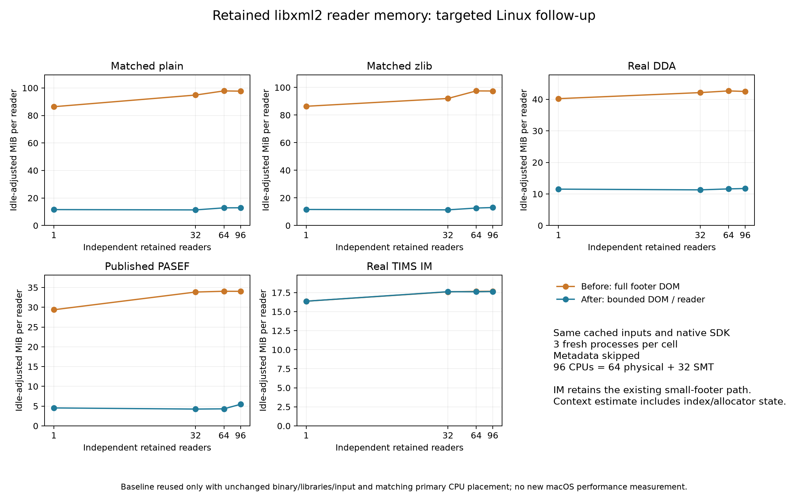
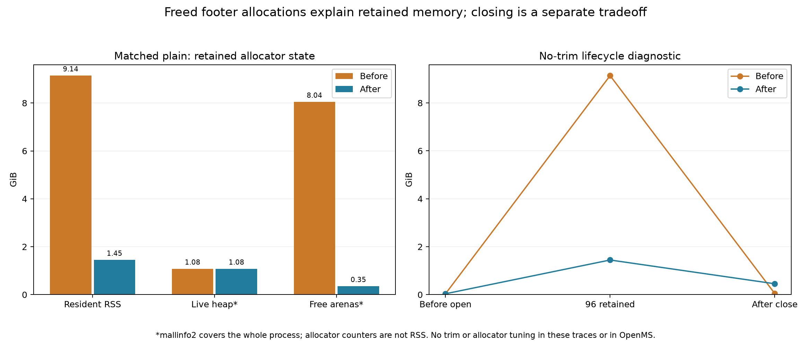

# Detailed targeted results

All numbers below summarize three fresh processes per cell. Whole-workload seconds, global synchronized reads including close/join, and per-worker query loops have different boundaries. The per-process median worker time is summarized across the three processes. Ratios of medians are descriptive, not significance tests. The final primary phase uses the reused baseline's0–95 CPU mask at every N; sustained rows explicitly identify their own placement. The96-CPU set contains 64 physical cores plus 32 SMT siblings.

## Retained context and indexed RSS at 96

| Input | Retained MiB/reader, before → after | Reduction | 96-reader random-read peak MiB, before → after | Post-read residue MiB, before → after |
|---|---:|---:|---:|---:|
| Matched plain | 97.7 → 12.9 | 86.8% | 9,532 → 1,863 | 52 → 962 |
| Matched internal zlib | 97.4 → 13.0 | 86.6% | 9,537 → 1,922 | 52 → 800 |
| Real Lumos DDA | 42.5 → 11.7 | 72.4% | 4,222 → 1,274 | 85 → 68 |
| Published PASEF | 34.0 → 5.5 | 84.0% | 3,323 → 614 | 62 → 326 |
| Real TIMS IM | 17.7 → 17.7 | 0.2% | 1,769 → 1,762 | 52 → 52 |

Whole streaming/load/decompression results remain in the unchanged [previous handoff](../gap-bench/REPORT.md), with their own older product source. These numbers are current before/after libxml2 comparisons, not a fresh current-source Xerces comparison.

## Per-reader context scaling

| Input | Readers | Before MiB/reader | After MiB/reader | Reduction |
|---|---:|---:|---:|---:|
| Matched plain | 1 | 86.36 | 11.57 | 86.6% |
| Matched plain | 32 | 94.84 | 11.35 | 88.0% |
| Matched plain | 64 | 97.85 | 12.84 | 86.9% |
| Matched plain | 96 | 97.67 | 12.90 | 86.8% |
| Matched internal zlib | 1 | 86.37 | 11.62 | 86.5% |
| Matched internal zlib | 32 | 92.02 | 11.35 | 87.7% |
| Matched internal zlib | 64 | 97.49 | 12.65 | 87.0% |
| Matched internal zlib | 96 | 97.44 | 13.03 | 86.6% |
| Real Lumos DDA | 1 | 40.20 | 11.53 | 71.3% |
| Real Lumos DDA | 32 | 42.12 | 11.30 | 73.2% |
| Real Lumos DDA | 64 | 42.66 | 11.60 | 72.8% |
| Real Lumos DDA | 96 | 42.49 | 11.73 | 72.4% |
| Published PASEF | 1 | 29.37 | 4.54 | 84.5% |
| Published PASEF | 32 | 33.85 | 4.25 | 87.5% |
| Published PASEF | 64 | 34.05 | 4.31 | 87.3% |
| Published PASEF | 96 | 34.03 | 5.46 | 84.0% |
| Real TIMS IM | 1 | 16.37 | 16.38 | -0.0% |
| Real TIMS IM | 32 | 17.60 | 17.62 | -0.1% |
| Real TIMS IM | 64 | 17.66 | 17.62 | 0.3% |
| Real TIMS IM | 96 | 17.68 | 17.65 | 0.2% |

## Sustained read confirmations

Speedup is baseline time / final time;>1 is faster. The query-loop column excludes open/barriers/destruction. The global read-phase column includes destruction/join. Masks are allowed CPUs, not a claim of pinned per-worker placement. `0..N-1` uses physical CPUs through 64; `0..95` matches the original primary placement. No rows with different masks/query lengths are pooled.

| Input | Readers | CPU mask | Query-loop speedup | Global read + close speedup | Complete workload speedup |
|---|---:|---|---:|---:|---:|
| Matched plain | 64 | 0..95 | 1.021× | 1.067× | 3.019× |
| Matched plain | 64 | 0..N-1 | 0.993× | 1.127× | 3.001× |
| Matched plain | 96 | 0..N-1 | 1.008× | 1.166× | 4.074× |
| Matched internal zlib | 64 | 0..95 | 1.006× | 1.090× | 2.559× |
| Matched internal zlib | 64 | 0..N-1 | 0.999× | 1.253× | 2.713× |
| Real Lumos DDA | 1 | 0..N-1 | 0.988× | 0.989× | 1.025× |
| Real Lumos DDA | 32 | 0..95 | 0.985× | 1.004× | 1.627× |
| Real Lumos DDA | 64 | 0..95 | 0.982× | 0.973× | 1.643× |
| Real Lumos DDA | 64 | 0..N-1 | 1.001× | 0.748× | 1.516× |
| Published PASEF | 64 | 0..95 | 0.992× | 0.950× | 1.294× |
| Published PASEF | 64 | 0..N-1 | 1.004× | 0.846× | 1.208× |
| Real TIMS IM | 1 | 0..N-1 | 1.001× | 1.001× | 0.997× |
| Real TIMS IM | 32 | 0..N-1 | 0.994× | 0.971× | 1.004× |
| Real TIMS IM | 64 | 0..N-1 | 0.991× | 1.032× | 1.021× |
| Real TIMS IM | 96 | 0..N-1 | 1.046× | 1.000× | 1.027× |

## Mechanism and rejected alternatives

On the plain 96-reader no-trim diagnostic, baseline resident RSS is 9.81 GB with about 1.15 GB live allocations and 8.63 GB free arena bytes. The final candidate is 1.55 GB resident with the same live allocation total and 0.37 GB free arena bytes. After destroying readers, baseline is 52.6 MB and final 487.5 MB (about 448.5 MB free arenas). These are individual diagnostic processes rather than the canonical three-run context medians; do not replace one counter/phase with another. Glibc arena history varies with scheduling. The larger final post-close residue is allocator retention, not a guarantee of a leak or a promise that the OS immediately receives freed pages.

The initial all-reader implementation cut retained IM RSS but caused substantial sustained query-loop regressions and many more minor page faults. A getter buffer-copy experiment did not fix it. Contiguous packed IDs, including a preallocation variant, preserved loops but left much larger retained RSS. Exact sources, review findings and their failed/diagnostic results remain archived. Fixed malloc-threshold probes disable glibc's normal dynamic heuristics and were not adopted. No fastest-repetition or fastest-candidate result is substituted into the final phase.

The selected strategy restores the original DOM path only below a2 MiB wrapped-footer bound, avoiding the observed small-IM allocator/read-loop regression; large indices use the reader path. Actual tails are about 1.63 MB IM,2.17 MB PASEF,4.69 MB DDA and6.38–6.41 MB generated. The threshold includes the 14-byte artificial wrapper/newline. A different acquisition, spectrum size, allocator or library version may need further evaluation. IM still has roughly 17.7 MiB retained overhead per reader, so its previous Xerces memory advantage remains a historical comparison, not solved here.

## Evidence boundaries and gates

The final selected 324-record initial stage is 132 reused baseline plus 192 fresh final processes. Five final primary short-loop flags triggered 30 further fresh confirmations at the same primary CPU placement, making354 selected records/118 cells. Both stages have complete identities, schedules, native exit checks, cache gates and every repetition. Untimed controls, allocator probes, all-reader/copy/packed rejected versions, and the stopped wrong-affinity pilot are kept separate. The table retains those rejected summary cells with explicit labels and source identities.

The final source is checked against all 9,307 regular archived files with only decoder, decoder tests and READER CMake discovery changed. The actual compiled hashes match the committed blobs. Source/input/native harness/mapped DLL identities stay unchanged over timings; complete offset-vector fingerprints match both versions on all five files. SDK footer controls pass20/20 per platform for small/large paths, malformed tail/junk/NUL, duplicates, truncation, conversion/XML error precedence, namespaces/entities/CDATA/nested content and missing IDs. The proposed trailing-junk reader defect was not reproduced on 2.15.4. Product output vectors now stay unchanged on failure; alias last-type behavior is preserved. Final seven/four focused suites are not a rerun of the previous full Linux/macOS747/746 suites.

[Raw evidence](raw/) · [Accepted phase summary](summary.csv) · [Sustained summary](sustained-summary.csv) · [All platforms/phases](all-comparisons.csv) · [Reproduction](reproduce/README.md) · [Review decisions](review/DECISIONS.md)
