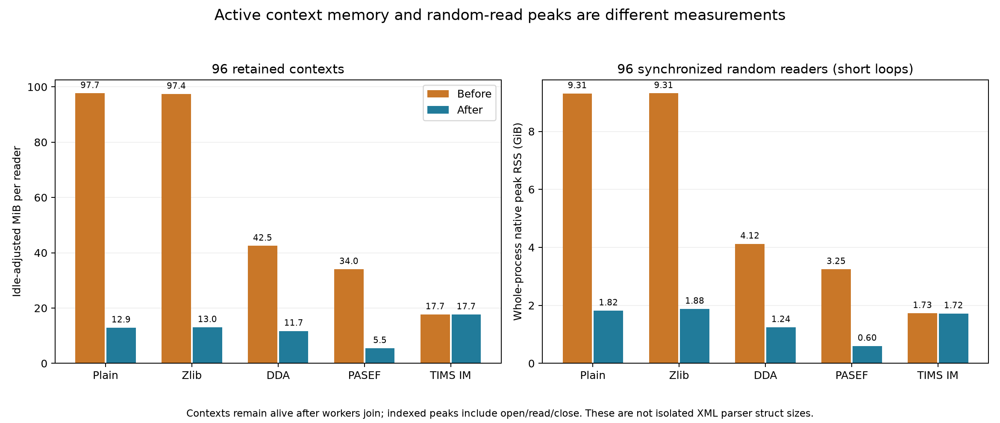
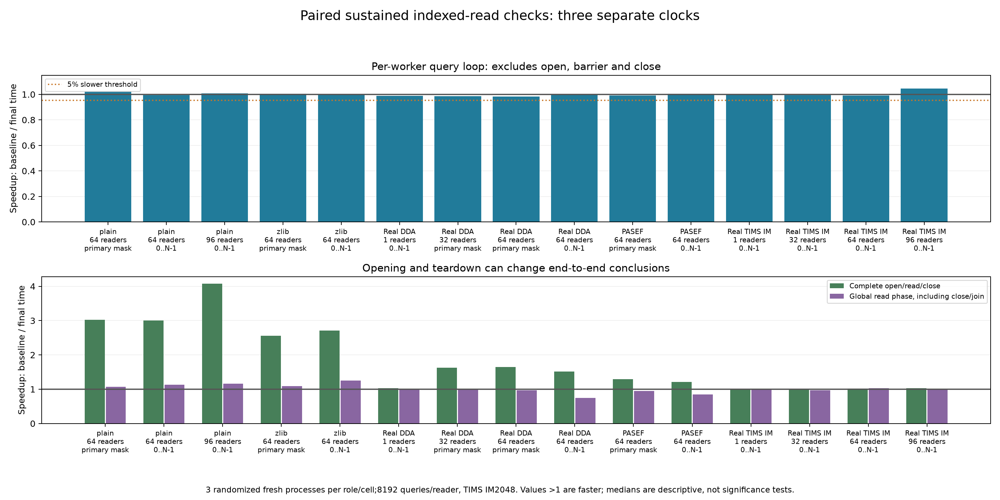

# Retained-context memory and indexed-read follow-up

Product source: `ac0e80acbe46102e0305a672c07bc38a81f3f164`, compared with the previous complete libxml2 replacement (`8f66b3d9`, code-identical to publication `441ac13`). **Linux checks through 96 readers are complete.** This changes footer traversal; streaming, whole-document loads and decompression were not rerun.

At 96 retained readers, memory per reader falls **72–87% on four inputs**. The small IM footer keeps the original path and its memory stays unchanged. The implementation uses the existing DOM for wrapped footers ≤ 2 MiB and forward-only `xmlTextReader` above that bound. It requires libxml2 READER support. There is no allocator tuning or trim call in OpenMS.

| Input | Retained MiB/reader, before → after | Reduction | 96-reader random-read peak MiB, before → after | Post-read residue MiB, before → after |
|---|---:|---:|---:|---:|
| Matched plain | 97.7 → 12.9 | 86.8% | 9,532 → 1,863 | 52 → 962 |
| Matched internal zlib | 97.4 → 13.0 | 86.6% | 9,537 → 1,922 | 52 → 800 |
| Real Lumos DDA | 42.5 → 11.7 | 72.4% | 4,222 → 1,274 | 85 → 68 |
| Published PASEF | 34.0 → 5.5 | 84.0% | 3,323 → 614 | 62 → 326 |
| Real TIMS IM | 17.7 → 17.7 | 0.2% | 1,769 → 1,762 | 52 → 52 |

Retained estimates subtract same-N idle RSS and include index/allocator state. Indexed peaks cover the complete short-loop workload. Post-read residue is sampled after readers are destroyed; **the lower active footprint does not guarantee lower RSS after closing**. In the plain case that residue rises from 52 to 962 MiB. Separate no-trim probes show freed arena bytes rather than live parser objects; this tradeoff remains visible.

The final **15 paired sustained settings** use 8192 queries/reader (IM 2048), three fresh processes per role. Query-loop time is at most **1.8% slower** than baseline across those settings; the largest throughput gain is 4.6%. These descriptive medians pass the 5% investigation gate, but are not a proof of equivalence on other inputs or allocators. IM checks include 1/32/64/96 readers. Five 23–100 ms short-loop flags received longer confirmations at their exact original CPU placement; every repetition is retained.

Opening and closing must be distinguished from query loops. In the fixed-physical-mask confirmations, complete open/read/close workloads are 1.52× faster for DDA 64 and 1.21× for PASEF 64, yet their **global read phase including teardown/join is 34% and 18% slower**, respectively. Plain 96 complete-workload throughput is 4.07× higher. The full clocks, ranges, CPU masks and outcomes are in the [details](DETAILS.md) and [combined table](all-comparisons.csv).

The all-reader-only attempt was rejected: it saved memory on IM too but slowed sustained IM loops. Buffer-copy removal and packed-ID alternatives also remain separately recorded. The 2 MiB cutoff is a bounded compromise demonstrated on these files, not an adaptive or universally optimal rule.

**Validation:** seven Linux and four macOS focused suites pass, plus 20 independent footer controls on each platform. Complete index IDs/order/offsets and sampled query digests agree; 9,307 archived source files, actual compiled/committed file hashes, mapped libraries, cached inputs, native exits and schedules were verified. Codex, Kimi and Claude Opus 5.5 reviews are [retained with dispositions](review/DECISIONS.md). This is 222 fresh final measurements plus 132 unchanged baseline records: 354 selected records/118 cells. Controls, rejected iterations and the stopped affinity pilot are separate.

The [one combined table](all-comparisons.csv) has **3,674 cells**, preserving the previous 3,488 macOS/Linux cells and labeling every new accepted/rejected phase. Prior [macOS build/encoding evidence](../gap-bench/REPORT.md) stays separate: no new macOS performance, compressed-data, whole-load or decompression measurement is claimed for this source. Windows, sanitizers, minimum-version execution, cold I/O and other IM encodings remain untested here; the old full 747/746-suite results belong to the earlier source.

[Memory scaling graph](figures/context-memory-scaling.png) · [Allocator/lifecycle graph](figures/allocator-diagnostic.png) · [Detailed findings](DETAILS.md) · [Methods and reproduction](reproduce/README.md)
