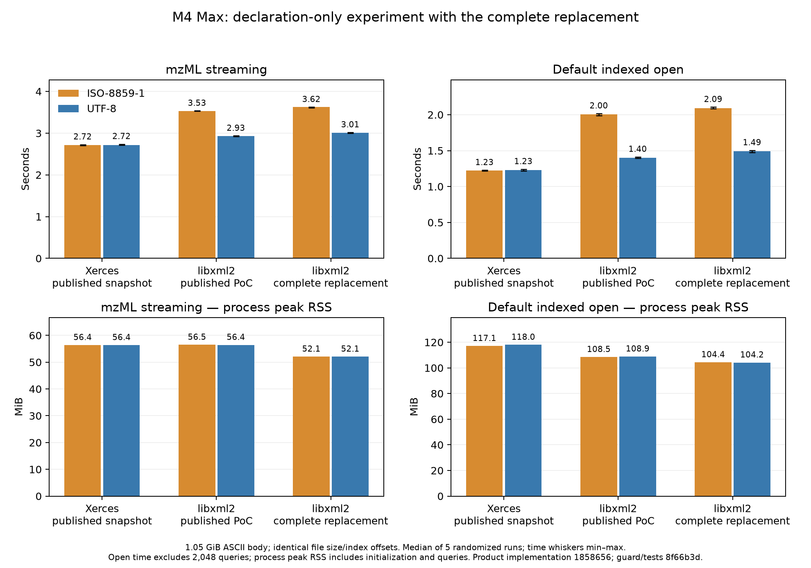

# Final encoding, timing and RSS confirmation

This repeats [Timo’s requested declaration experiment](https://github.com/OpenMS/OpenMS/issues/10623#issuecomment-6284417895) after the final product corrections: source `8f66b3d921c9512e1e5968f494c77715ff71c696`, with unchanged runtime implementation from `1858656a86869ba462545a9232b89a0e1e1c319c`. The final four-file commit changes only the removal guard and regression tests. The [earlier cbb180a experiment](../encoding-followup/README.md) remains separate evidence.

The same 1,126,185,409-byte files differ only in their first-line declaration: ISO-8859-1 versus UTF-8 padded with five spaces. Their entire body is ASCII, all index offsets remain unchanged, and the generated checksum placeholder is not validated. The final run used the frozen published optimized Xerces/libxml2 PoC snapshots and the current native library, one reader, OpenMP/BLAS=1, cached input, five randomized repetitions per cell. It began after the complete local test suite finished; an overlapping exploratory run was discarded. All 60 decoded fingerprints agree, all library hashes stayed unchanged, and no elapsed/process/CPU consistency check was flagged.

| Implementation | Declaration | Stream s | Default open s | Stream peak MiB | Open+queries peak MiB |
|---|---|---:|---:|---:|---:|
| Xerces snapshot | ISO-8859-1 | 2.719 | 1.225 | 56.4 | 117.1 |
| Xerces snapshot | UTF-8 | 2.718 | 1.230 | 56.4 | 118.0 |
| libxml2 PoC snapshot | ISO-8859-1 | 3.531 | 2.004 | 56.5 | 108.5 |
| libxml2 PoC snapshot | UTF-8 | 2.929 | 1.401 | 56.4 | 108.9 |
| Complete libxml2 replacement | ISO-8859-1 | 3.625 | 2.089 | 52.1 | 104.4 |
| Complete libxml2 replacement | UTF-8 | 3.010 | 1.491 | 52.1 | 104.2 |

Times and RSS are medians of five separate processes. Default-open time excludes the subsequent 2,048 random queries; peak RSS and CPU counters include initialization and queries. The figure’s time whiskers show min–max.

For the complete replacement, UTF-8 reduces streaming time **17.0%** and default-open time **28.6%**. Its penalties versus Xerces shrink from **33.3% to 10.7%** for streaming, and **70.5% to 21.2%** for opening. Its peak RSS is about 52.1 MiB for streaming and 104.2 MiB for UTF-8 metadata opening plus queries, versus Xerces’s 56.4 and 118.0 MiB.
For the published libxml2 PoC, UTF-8 reduces streaming by 17.0% and opening by 30.1%; its UTF-8 penalties versus Xerces are 7.8% and 13.9%. Xerces’s encoding medians differ by less than 0.4%.

This supports the proposed per-byte encoding-conversion explanation for much of the macOS gap on this ASCII-body input. It does not profile a converter function or prove that encoding explains every Linux/macOS difference. Absolute timings vary between sessions; compare backends within each randomized phase. OpenMS uses Release `-O3`, but the Homebrew parser bottle flags were not normalized to that setting. No new Latin-1-as-UTF-8 shortcut was added. Timo’s alternative `libxml2-fast` branch, Time Profiler and a paired Linux declaration experiment were not run.

[One combined table](all-comparisons.csv) contains **2,776 summary cells**: 2,752 historical cross-platform prototype cells, 12 prior encoding cells, and 12 final encoding cells, each summarizing five runs (**13,880 process records**, excluding the separately archived clock-confirmation runs). `evidence_phase`, `variant`, `matrix` and the source/library identities distinguish measurements; `seconds_median` remains the entire workload, while `job_open_seconds_median` isolates opening. Historical whole-load RSS, parallel random-read context overhead and scaling to 96 Linux threads remain the earlier prototype measurements; they were not rerun for the complete migration.

[Raw final runs](benchmarks.json), [summary](summary.json), [dependency hashes and command](experiment.json), [input preparation](input-preparation.json) and the scripts accompany the graph. Reproduction scripts assume their original workspace layout under `results/encoding-final185/`, with the existing generated input, frozen snapshots and benchmark binary; the plotting script uses matplotlib.
