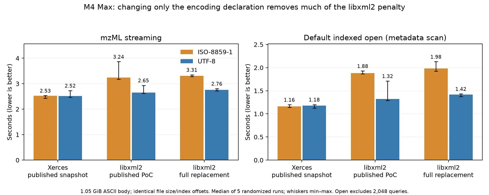

# Timo’s M4 Max encoding experiment

Changing only the declaration explains much of the measured macOS libxml2 penalty for this input. It does not establish that all macOS/Linux differences have one cause. This answers [Timo’s requested experiment 1](https://github.com/OpenMS/OpenMS/issues/10623#issuecomment-6284417895); his alternative adapter branch and Time Profiler experiment were not used.

The 1,126,185,409-byte generated `large.mzML` has an ASCII-only body. The UTF-8 copy changes only its first-line encoding declaration, padding with five spaces to preserve file size and every index offset. Both files retain the generated checksum placeholder `0`; the benchmark checks decoded data, not that placeholder. Original and derived input hashes are recorded.

We used the published optimized Xerces/libxml2 PoC snapshots and the complete libxml2 replacement at `cbb180af857f1c89956db8ac5128e4182d9b9ea8`, with unchanged dependency binaries throughout the run. One independent reader, OpenMP/BLAS=1, cached input, five randomized repetitions for each backend/declaration/path: 60 successful process runs. All decoded fingerprints agree across declarations and backends. No elapsed/process/CPU clock consistency check was flagged.

| Implementation | Declaration | Stream s | Default open s | Stream peak MiB | Open+queries peak MiB |
|---|---|---:|---:|---:|---:|
| Xerces snapshot | ISO-8859-1 | 2.526 | 1.164 | 56.2 | 116.3 |
| Xerces snapshot | UTF-8 | 2.519 | 1.178 | 56.5 | 116.7 |
| libxml2 PoC snapshot | ISO-8859-1 | 3.243 | 1.880 | 56.4 | 108.2 |
| libxml2 PoC snapshot | UTF-8 | 2.651 | 1.323 | 56.5 | 108.4 |
| libxml2 full replacement | ISO-8859-1 | 3.312 | 1.984 | 52.3 | 104.4 |
| libxml2 full replacement | UTF-8 | 2.759 | 1.418 | 52.3 | 104.1 |

Times and process peak RSS are medians of five runs. Default-open time is the metadata/index opening phase, excluding the subsequent 2,048 random queries; RSS and process CPU counters include initialization and those queries. The graph shows min–max ranges, and raw records retain all samples and phase times.

For the published libxml2 PoC, UTF-8 reduces streaming time by **18.2%** and default-open time by **29.6%**. Its overhead relative to Xerces falls from **28.4% to 5.2%** for streaming and **61.5% to 12.3%** for default open. Xerces medians change by less than 1.3%, with overlapping ranges. This is consistent with Timo’s proposed per-byte Latin-1 conversion cost; it is not a function-level profile proving the exact converter’s sample share.

For the complete replacement, UTF-8 reduces streaming time by **16.7%** and default open by **28.5%**. Relative to Xerces, it remains **9.5% slower** for UTF-8 streaming and **20.3% slower** for UTF-8 default open; the ISO-8859-1 penalties are 31.1% and 70.5%. The full replacement is also modestly slower than the frozen PoC in these paths, while its measured peak RSS is lower. These costs remain visible rather than treating the declaration experiment as a universal win.

The original OpenMS builds used Release `-O3`; that does not establish that Homebrew’s parser bottles were compiled with the same flags. Parser binaries were not rebuilt or changed between declarations in this experiment. Linux’s paired declaration experiment, a native-parser `-O2`/`-O3` comparison, the `libxml2-fast` adapter and a Time Profiler trace were not run here. No production shortcut that treats arbitrary Latin-1 as UTF-8 was introduced; any such optimization must preserve non-ASCII content, declared/enforced encodings, chunk boundaries and error handling. Whole-load RSS and 96-thread scaling remain the earlier cross-platform experiments, not newly measured encoding results.

[All original cross-platform cells plus these 12 new summary cells](all-comparisons.csv) form one table, with an explicit evidence-phase column. The combined table keeps `seconds_median` as whole-workload time; use `job_open_seconds_median` for opening alone. The new rows retain the exact loaded OpenMS hash and identify the full-removal source commit; earlier rows retain their original provenance in the published benchmark handoff. [Raw 60 runs](benchmarks.json), [phase/RSS/CPU summary](summary.json), [experiment and dependency hashes](experiment.json), and [input preparation](input-preparation.json) accompany the figure.

Reproduce the preparation and runner from the workspace containing the original `benchmark-data/large.mzML`, benchmark executable and frozen snapshots; the scripts preserve the original and create `large-utf8.mzML`. The plotting script uses the existing plotting environment with matplotlib and a writable MPLCONFIGDIR. The original historical benchmark evidence remains byte-for-byte unchanged.

A [final post-review confirmation](../encoding-final/README.md) repeats this experiment against the completed replacement; use its [combined table](../encoding-final/all-comparisons.csv) to include both encoding phases.
