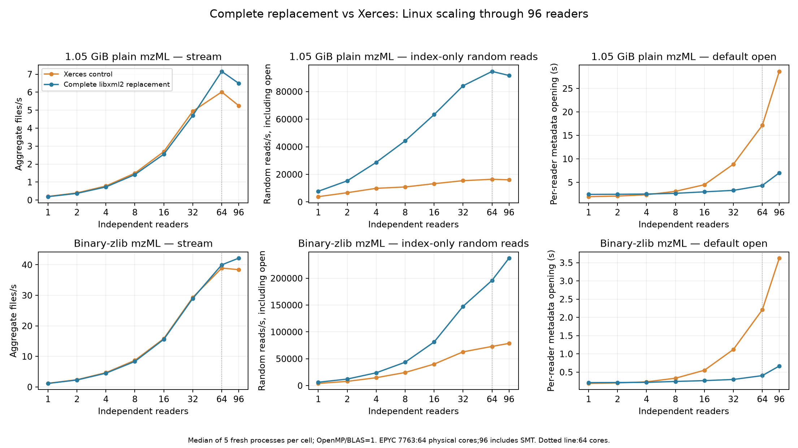
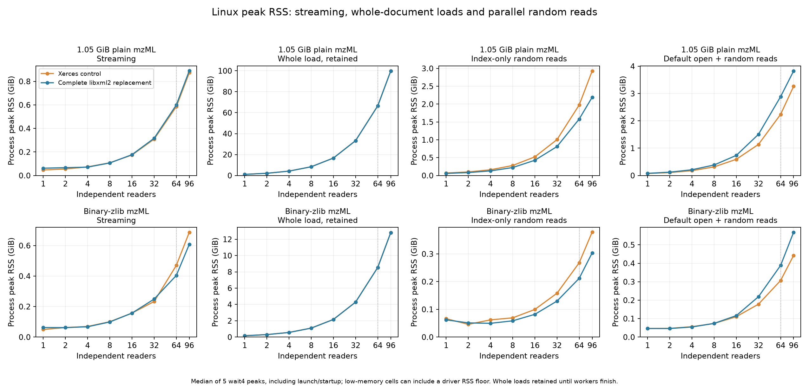
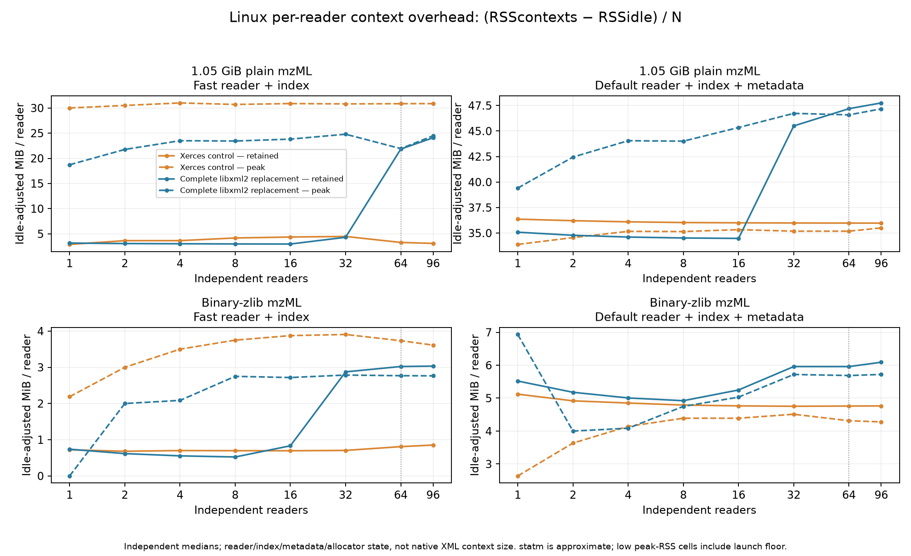
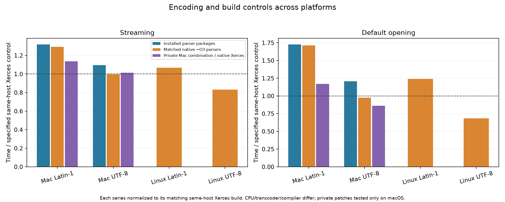

# Complete replacement: Linux through 96 threads and macOS options

This follow-up measures the **complete** replacement at `8f66b3d921c9512e1e5968f494c77715ff71c696` against the previously reviewed optimized Xerces control `58aa37348c968a12e3285295f28c197cc0b7bdbe`, not the old libxml2 PoC. Later feature-branch commits only publish documents. Both Linux backends were rebuilt with GCC 13.3, C++23 and `-O3 -DNDEBUG`, using private unpatched libxml2 2.15.4 / Xerces 3.3.0 and the same dependencies, inputs and harness. The full-replacement process maps no Xerces library.

Linux uses ibminode05, EPYC 7763: 64 physical cores / 128 hardware threads, with CPUs 0–95 available to the timed processes. Thus 96 includes 32 SMT siblings. Each measured cell has five randomized fresh-process runs; inputs are cached, not a cold-storage benchmark. Independent-reader tests use OpenMP/BLAS=1; separate fixed-work tests vary the requested OpenMP team through 96. Workers in each cell read the same cached file and deterministic query sequence, each owning its own state; this is neither a 96-file storage test nor proof of shared-object thread safety.

The fresh Linux matrix has **2,280 process runs**: six-input streaming/indexed/open workloads, whole-document loads, retained fast/default contexts, fixed-work OpenMP and a paired declaration control. There are **280 additional macOS build/encoding/source-option runs**. [One combined table](all-comparisons.csv) contains **3,288 summary cells** across historical and fresh phases, with source/build/library/patch identities; **2,560 new process records** are included. `seconds_median` is whole-workload time; `job_open_seconds_median` isolates opening. Historical data remain unchanged.

## Linux performance

| Input | Backend | Stream files/s, 1 reader | Stream files/s, 96 readers | Best stream files/s (readers) |
|---|---|---:|---:|---:|
| 1.05 GiB plain | Xerces | 0.202 | 5.253 | 6.012 (64) |
| 1.05 GiB plain | libxml2 complete | 0.189 | 6.495 | 7.155 (64) |
| Binary-zlib | Xerces | 1.197 | 38.397 | 38.913 (64) |
| Binary-zlib | libxml2 complete | 1.162 | 42.153 | 42.153 (96) |

On the large/plain input, libxml2 is 6.6% slower for one streaming reader, but delivers 23.6% more aggregate throughput at 96 readers. Its 96-reader index-only query workload is 5.71× faster. RSS is a tradeoff: whole-load memory is essentially equal, streaming memory is slightly higher, and retained fast-reader overhead is higher despite a lower fast-query peak; the default metadata-plus-query path uses more peak memory.

Random-read throughput includes opening and 2,048 deterministic queries per reader; default metadata-opening phase time is shown separately in the figure and table. Reader throughput and single-reader OpenMP speedup answer different questions. For fixed-work OpenMP, the measured best settings are:

| Input | Backend | Best speedup vs own 1-thread run | Requested threads at best | Peak RSS at 96 (MiB) |
|---|---|---:|---:|---:|
| Plain | Xerces | 1.25× | 64 | 48.0 |
| Plain | libxml2 complete | 1.23× | 64 | 46.0 |
| Binary-zlib | Xerces | 1.95× | 32 | 47.0 |
| Binary-zlib | libxml2 complete | 1.85× | 64 | 47.0 |

[OpenMP speed and RSS graph](figures/linux-openmp.png). Four post-matrix stream probes observed **97 native process threads with 96 readers / OpenMP=1**, and **192 with one reader / requested OpenMP=96**, on both backends. These probes are excluded from performance counts. Retained initialization/runtime teams mean the latter does not isolate a single 96-thread pool or SMT effects.

## RSS and per-reader overhead

The peak-RSS comparison covers streaming, retained whole loads, fast indexed queries and default metadata-plus-query paths at every reader count. These are whole-process `wait4` peaks including launch/startup. A post-run empty-target calibration measured 11→139 MiB when the Python parent allocated an extra 128 MiB: pre-exec accounting can impose a floor on low-memory cells. Exact per-cell parent RSS was not recorded, so small peaks are not pure parser footprints and differences below the driver floor should not be ranked. Large 96-reader peaks exceed this floor; the in-process retained `statm` samples do not include it. At 96 readers:

| Input | Path | Xerces peak GiB | Complete libxml2 peak GiB |
|---|---|---:|---:|
| Plain | Streaming | 0.874 | 0.890 |
| Plain | Whole load, retained | 99.806 | 99.775 |
| Plain | Fast random reads | 2.929 | 2.192 |
| Plain | Default open + random reads | 3.263 | 3.826 |
| Binary-zlib | Streaming | 0.687 | 0.608 |
| Binary-zlib | Whole load, retained | 12.802 | 12.818 |
| Binary-zlib | Fast random reads | 0.379 | 0.304 |
| Binary-zlib | Default open + random reads | 0.443 | 0.568 |

Per-reader context estimates subtract the matching idle median before dividing by reader count. These are **reader + index/metadata + allocator-retention** estimates, not `sizeof(xmlParserCtxt)`: indexed fragment parser objects are transient, and query-path peak RSS includes them. The retained sample is taken after worker threads join while reader objects remain alive; it excludes live worker-stack costs. Linux `statm` is approximate; retained and `wait4` peak counters are kept distinct. At 96 readers:

| Input | Retained reader path | Xerces extra MiB/reader | libxml2 extra MiB/reader |
|---|---|---:|---:|
| Plain | Fast index | 3.10 | 24.08 |
| Plain | Default metadata | 35.98 | 47.76 |
| Binary-zlib | Fast index | 0.85 | 3.03 |
| Binary-zlib | Default metadata | 4.76 | 6.09 |

[Context table](linux/context-overhead.csv) retains every count and both resident/peak estimates. Whole-document output data are deliberately retained until all workers finish; their RSS is not a streaming parser footprint.

## macOS and Timo’s question

[Controlled macOS results and options](MACOS_OPTIONS.md) separate three effects: encoding, build configuration, and two private source experiments. A local unpatched `-Os` libxml2 build reproduces the installed bottle’s Latin-1 times within 0.1%; `-O2` reduces them about 14% for streaming and 23% for opening, whereas `-O2` versus `-O3` alone makes little difference. Homebrew’s recorded Clang default is `Os`, so formulas and Release labels did not establish the earlier O2/O3 assumption.

The private converter/ignored-binary combination improves Latin-1 streaming/opening by 23.1%/47.6% versus the Homebrew-backed complete replacement, with about 52/104 MiB RSS. It is **not shipped** in the canonical branch or used in the Linux runs. Under matched native `-O3` builds it still trails Xerces on Latin-1 by 13.7%/16.9%; on UTF-8 the unpatched builds are near parity and the combination opens 13.7% faster. Honest UTF-8 serialization and speed-optimized parser builds are practical options before a wider adapter rewrite.

The separate paired declaration controls give these libxml2 time differences against matching same-host native Xerces builds (negative is faster):

| Host, native -O3 | Declaration | Streaming | Default opening |
|---|---|---:|---:|
| macOS M4 Max | ISO-8859-1 | +29.4% | +71.5% |
| macOS M4 Max | UTF-8 | -0.3% | -2.3% |
| Linux EPYC | ISO-8859-1 | +6.7% | +24.0% |
| Linux EPYC | UTF-8 | -16.9% | -31.6% |

Different CPU, compiler, allocator and Xerces transcoder choices remain confounded across hosts. The paired Linux and macOS declaration controls isolate encoding effects on this ASCII-body input; they do not justify blind header changes to real Latin-1 files.

## Evidence and limits

The Xerces Linux rebuild passed all 25 focused XML tests; the complete replacement passed all 28, each benchmark correctness suite, and million-point stream/load/index equivalence; the full replacement’s source/library dependency guard passed. Every final measured cell has five records and matching decoded fingerprints; library hashes and input hashes are checked before/after. The actual source archives and benchmark executable are pinned. The broader 747-test Linux validation remains available in the parent migration report.

The private macOS converter passed all eight native suites per build, 51,472 oracle cases and 65 exact in-place ASCII cases; the combined handler candidate passed 12 focused OpenMS tests and 24 malformed/non-ASCII payload controls. Independent Kimi/Opus reviews and the Codex caller review are retained. Native Xerces’s one upstream DOM baseURI-test failure also reproduces with the installed bottle; it is disclosed rather than counted as passing. Windows, Docker and sanitizers were not newly run.

Raw matrices, summaries, hashes, resource/load/swap observations and reproduction scripts are included. All 62 copied Linux result/log files passed transport checksum verification before the successful dedicated task-owned scratch root was removed; shared contrib was preserved. The [cleanup receipt](linux/cleanup.json) records the outcome. The resource log shows at least 880 GiB available and unchanged swap-in/out counters throughout the timed matrices.
