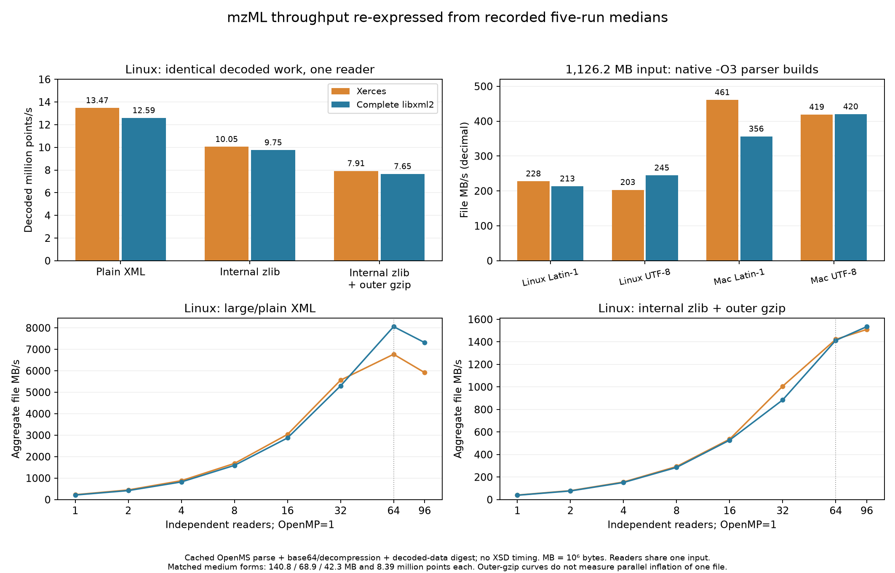

## Throughput in MB/s and remaining benchmark gaps

In response to [Chris’s request](https://github.com/OpenMS/OpenMS/issues/10623#issuecomment-6287602628), the existing measurements are re-expressed below. **These are derived rates from recorded five-run medians, not additional benchmark runs.** The production source, inputs and total measurement count have not changed.

**Units and workload:** MB = 1,000,000 bytes; MiB = 1,048,576 bytes. Aggregate file MB/s = `reader count × actual file bytes / median workload seconds / 1e6`. Timings cover cached OpenMS parsing, base64/decompression, decoded data and digest consumption, with shared warmup outside the workload timer. These are neither disk bandwidth nor isolated SAX timings; **XSD validation was tested separately and is not timed here**. Indexed workloads remain queries/s rather than dividing the entire file size by a partial read.

### Measured Linux technical flavours, one reader

All entries below declare Latin-1. The three medium forms contain exactly the same 4,096 spectra, one chromatogram and 8,392,704 decoded points; their decoded fingerprints match. The outer-gzip payload also expands byte-for-byte to the internal-zlib XML input. The 1,126.2 MB large/plain file is a different, larger workload.

| Input | Actual file MB | Xerces file MB/s | Complete libxml2 file MB/s |
|---|---:|---:|---:|
| Large, uncompressed arrays | 1,126.2 | 227.1 | 213.0 |
| Matched medium, uncompressed arrays | 140.8 | 225.9 | 211.1 |
| Same medium data, internal zlib | 68.9 | 82.5 | 80.0 |
| Same medium data, internal zlib + outer gzip | 42.3 | 39.9 | 38.5 |

Actual compressed-file MB/s changes its denominator. For the three identical medium workloads, decoded points/s and a common 140.758760 MB plain-XML equivalent show the work comparison more clearly. The equivalent rate is a normalization, not the number of compressed bytes read:

| Medium format | Xerces million points/s | libxml2 million points/s | Xerces plain-XML-equivalent MB/s | libxml2 plain-XML-equivalent MB/s |
|---|---:|---:|---:|---:|
| Matched medium, uncompressed arrays | 13.47 | 12.59 | 225.9 | 211.1 |
| Same medium data, internal zlib | 10.05 | 9.75 | 168.5 | 163.6 |
| Same medium data, internal zlib + outer gzip | 7.91 | 7.65 | 132.7 | 128.3 |

### Measured large-file encoding controls across platforms

Separate paired control phases use the 1,126.2 MB ASCII-body large input, one reader, and native `-O3` builds of both parser libraries. UTF-8 changes only the same-length declaration; offsets stay intact. These control timings are separate from the primary matrix above and do not justify changing arbitrary Latin-1 headers without transcoding.

| Host | Declaration | Xerces MB/s | Complete libxml2 MB/s |
|---|---|---:|---:|
| Linux EPYC | ISO-8859-1 | 227.7 | 213.3 |
| Linux EPYC | UTF-8 | 203.2 | 244.5 |
| macOS M4 Max | ISO-8859-1 | 460.8 | 356.2 |
| macOS M4 Max | UTF-8 | 418.8 | 420.0 |

The measured UTF-8 result does not support a universal Xerces speed advantage. Conversely, these workloads do not establish a winner for validation-enabled parsing or unmeasured acquisition types. CPU, compiler and transcoder differences still prevent an OS-only causal conclusion.

### Measured reader scaling versus unmeasured single-stream gzip scaling

The CSV contains every measured reader count: 1, 2, 4, 8, 16, 32, 64 and 96. Selected aggregate rates follow; all workers in a cell independently read the same cached input, with OpenMP=1. The node has 64 physical cores, so 96 readers include SMT.

| Input | Independent readers | Xerces aggregate file MB/s | libxml2 aggregate file MB/s |
|---|---:|---:|---:|
| Large, uncompressed arrays | 1 | 227.1 | 213.0 |
| Large, uncompressed arrays | 64 | 6,770.9 | 8,057.8 |
| Large, uncompressed arrays | 96 | 5,916.4 | 7,314.4 |
| Same medium data, internal zlib + outer gzip | 1 | 39.9 | 38.5 |
| Same medium data, internal zlib + outer gzip | 64 | 1,422.2 | 1,413.2 |
| Same medium data, internal zlib + outer gzip | 96 | 1,510.2 | 1,535.0 |

The separate fixed-work single-reader OpenMP matrix also has derived MB/s in the CSV, but varies binary decoding teams, not an outer-gzip inflater. Its 96-thread setting is qualified by the native-thread census in the main report. **No pigz or one-stream parallel-inflation benchmark was run.** Pigz’s [own manual](https://zlib.net/pigz/pigz.pdf) describes one main inflation thread for ordinary gzip and helper threads for reading, writing and checksum calculation; its compression parallelism should not be assumed for inflation.

### Still unmeasured

- A matched **at least 1 GB** corpus covering uncompressed arrays, internal zlib and outer gzip. The current matched compression fixture is 140.8 MB plain / 68.9 MB zlib / 42.3 MB gzip, not the large 1,126.2 MB file. Outer-gzip-only wrapping of the uncompressed-array form is also absent.
- Single-file outer-gzip decompression and end-to-end pipelines with 1–N decompression threads, including a separately measured pigz comparison or other explicitly named decompressor.
- Acquisition-stratified real PASEF, ion-mobility and DDA MS1/MS2 files. Generated data and one small BSA fixture do not establish representative performance for those acquisition schemes.
- Cold-storage bandwidth and validation-enabled throughput. No new macOS multi-reader or compressed-input full-replacement matrix is added here.

### Data and reproduction

[Fresh-phase derived rates, 512 cells](throughput/throughput-complete-replacement.csv) · [All phases/backends, 3,288 cells](throughput/throughput-all-phases.csv) · [Formulas, exact sizes and provenance](throughput/provenance.json) · [Selected tables](throughput/selected-tables.json) · [Vector graph](throughput/throughput.svg). The historical prototype rows retain their phase labels and existing clock caveats. File/load MB/s, MiB/s, inflated-XML and plain-equivalent rates, points/s, indexed queries/s and per-reader opening milliseconds are separate columns. Private macOS variants remain explicitly identified; they are not production changes.
