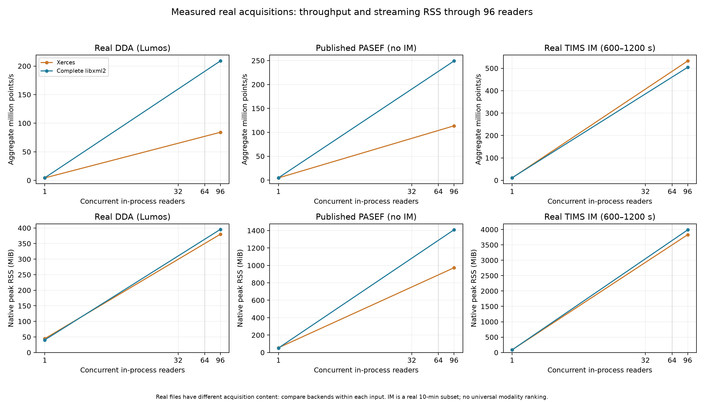
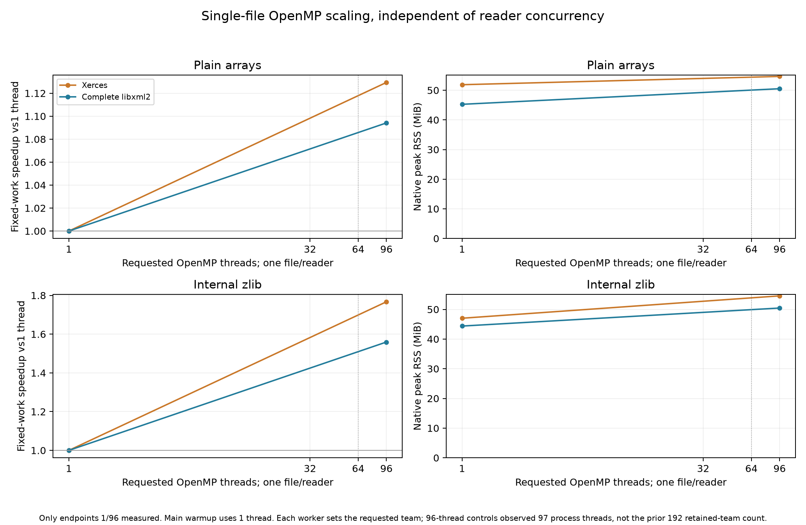
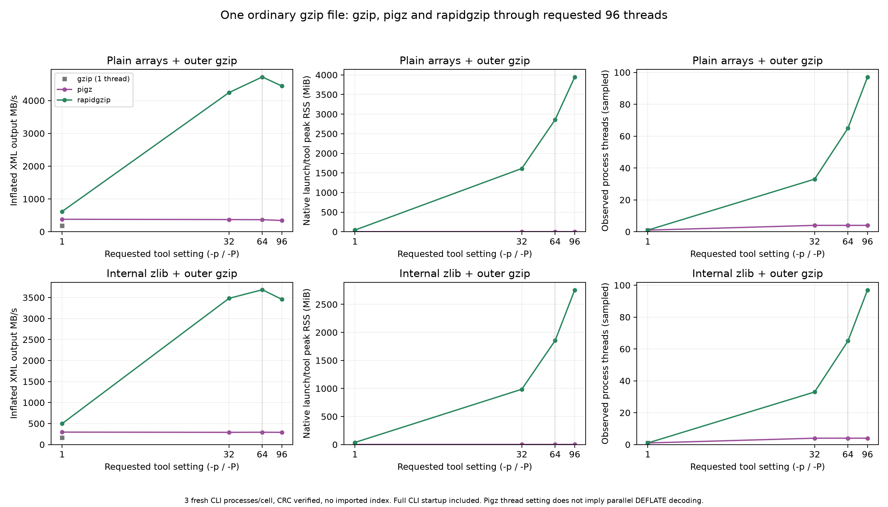
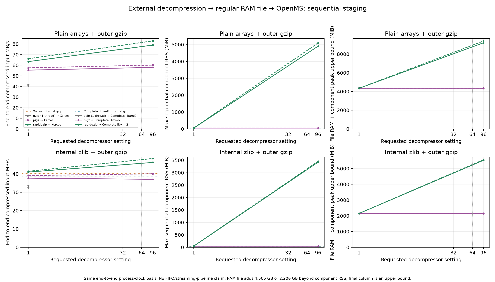
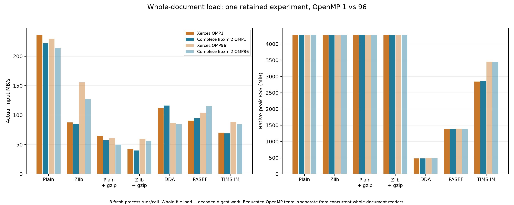
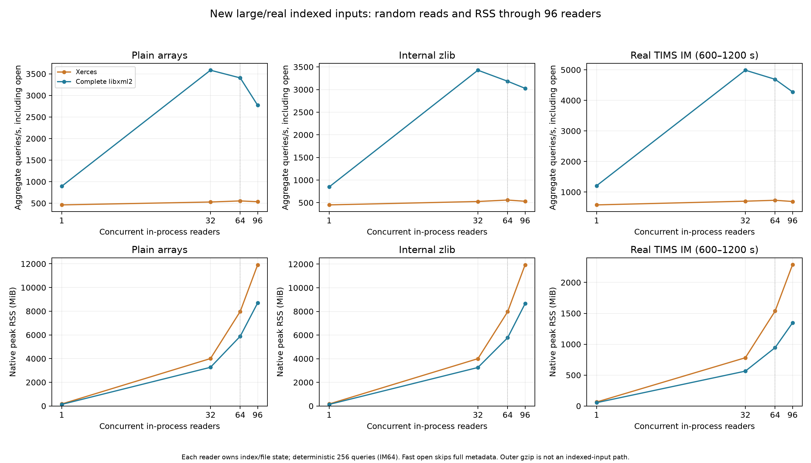
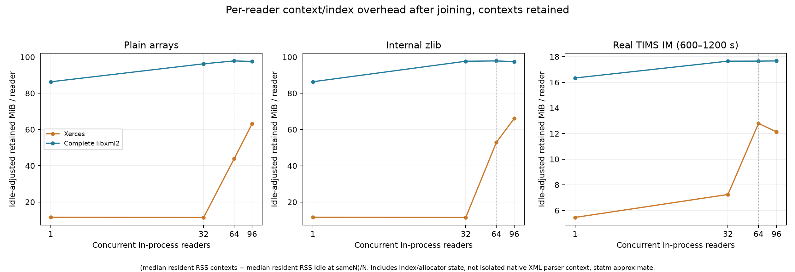

# XML replacement: large matched files, real acquisitions and single-file decompression

This phase measures the enumerated **Linux** cases with the user-requested reduced schedule: four matched files each ≥1,000,000,000 bytes; real DDA, published PASEF and a mobility-preserving real TIMS window; gzip/pigz/rapidgzip on **one gzip file** through requested96 threads. It also adds whole-document RSS, indexed-read RSS and retained-context overhead on these inputs. **600 fresh workload records / 660 native processes, three repetitions per cell; 200 new summary cells.** The [combined table](all-comparisons.csv) has 3,488 cells across platforms and phases. The user reduced the original schedule after 412 completed measurements. Selection prefers completed repetitions then original repetition number, never speed. Non-selected completed measurements remain supplemental raw evidence; the superseded28-record pilot stays separately excluded. Native source remains Xerces`58aa3734` versus complete libxml2`8f66b3d9`; no product-parser change was made for this phase.

**Interpretation:** compare backends within the same input. Independent readers are threads in one process reading the same cached inode; each has its own state. The96-CPU set contains 64 physical cores plus 32 SMT siblings. Requested tool/OMP settings, sampled process-thread counts and CPU-time/wall-time consumption (including runtime spin and startup) is a separate metric. XSD correctness was tested previously; XSD validation is not timed here.

## Matched and real inputs: one-reader throughput and RSS

Rates use the C++ workload clock. **Xerces / complete libxml2** in each paired column. MB is decimal; RSS MiB is binary. Compressed-file MB/s has a different byte denominator; points/s shows the common decoded work for the four matched forms.

| Input | Actual MB | Input MB/s, X / L | Million points/s, X / L | Peak RSS MiB, X / L |
|---|---|---|---|---|
| Matched plain | 4,505.1 | 227.9 / 213.7 | 13.6 / 12.7 | 51.9 / 45.3 |
| Matched internal zlib | 2,206.1 | 83.2 / 79.6 | 10.1 / 9.7 | 47.0 / 44.4 |
| Matched plain + outer gzip | 1,947.9 | 62.4 / 59.7 | 8.6 / 8.2 | 53.4 / 46.8 |
| Matched zlib + outer gzip | 1,369.7 | 40.5 / 38.9 | 7.9 / 7.6 | 48.6 / 45.8 |
| Real DDA (Lumos) | 617.2 | 118.0 / 123.8 | 4.3 / 4.5 | 44.6 / 40.4 |
| Published PASEF (no IM) | 1,453.8 | 89.3 / 93.4 | 4.6 / 4.8 | 54.6 / 51.6 |
| Real TIMS IM, 600–1200s | 961.7 | 70.2 / 73.7 | 10.7 / 11.2 | 85.8 / 85.5 |

The matched variants contain 131,072 spectra, one chromatogram and 268,566,528 decoded points, with identical base **and auxiliary** digests. Each gzip inflates byte-for-byte to its corresponding XML. The real inputs intentionally have different content; their throughput is not a ranking of acquisition technologies.

| Real input | Spectra | Decoded points | Finite IM-array values | Finite scalar-IM spectra |
|---|---|---|---|---|
| Real DDA (Lumos) | 53,521.0 | 22,449,914.0 | 0.0 | 0.0 |
| Published PASEF (no IM) | 44,296.0 | 75,304,002.0 | 0.0 | 0.0 |
| Real TIMS IM, 600–1200s | 22,544.0 | 146,159,507.0 | 135,013,049.0 | 22,032.0 |

DDA is public PXD008952; published PASEF and vendor TIMS data are MSV000101607/PXD077653. The published PASEF mzML has zero finite scalar/per-peak IM values. The separate TIMS conversion preserves IM for the actual 600.016465–1199.997447s window (22,032 finite precursor IM CV terms). It uses OpenMS **RATIONAL table calibration**, not a proprietary-SDK equivalence claim. Public URLs, original checksums, conversion source and configuration are in the evidence. The IM-only mutation test changes the auxiliary digest while leaving the peak digest unchanged; both backends agree on all seven inputs. This audit is not exhaustive equivalence of every metadata field. The matched/converted-IM XML declares Latin-1; public DDA/PASEF declares UTF-8. Inputs differ in content and encoding, so cross-input rates do not isolate acquisition or encoding effects. Both OpenMS backends use zlib1.3.1; system pigz uses zlib1.3. The complete runtime inventory is retained.

## Same-file reader scaling and memory

| Input | Readers | Aggregate million points/s, X / L | Peak RSS MiB, X / L |
|---|---|---|---|
| Matched plain | 1 | 13.6 / 12.7 | 51.9 / 45.3 |
| Matched plain | 64 | 418.0 / 496.9 | 590.2 / 510.8 |
| Matched plain | 96 | 359.9 / 439.4 | 732.0 / 807.7 |
| Matched internal zlib | 1 | 10.1 / 9.7 | 47.0 / 44.4 |
| Matched internal zlib | 64 | 425.0 / 441.2 | 412.9 / 425.8 |
| Matched internal zlib | 96 | 368.0 / 392.8 | 599.2 / 611.6 |
| Matched plain + outer gzip | 1 | 8.6 / 8.2 | 53.4 / 46.8 |
| Matched plain + outer gzip | 64 | 393.2 / 385.3 | 628.5 / 566.9 |
| Matched plain + outer gzip | 96 | 363.4 / 395.3 | 814.8 / 851.4 |
| Real DDA (Lumos) | 1 | 4.3 / 4.5 | 44.6 / 40.4 |
| Real DDA (Lumos) | 96 | 84.1 / 208.9 | 380.0 / 395.5 |
| Published PASEF (no IM) | 1 | 4.6 / 4.8 | 54.6 / 51.6 |
| Published PASEF (no IM) | 96 | 113.5 / 249.2 | 973.0 / 1,409.0 |
| Real TIMS IM, 600–1200s | 1 | 10.7 / 11.2 | 85.8 / 85.5 |
| Real TIMS IM, 600–1200s | 96 | 532.7 / 504.3 | 3,832.1 / 3,988.9 |

Single-file OpenMP is a separate fixed-work sweep through 96; it does not multiply input work. The new one-thread main warmup avoids the prior unused main-thread team: the 96-thread controls observed 97 process threads on both backends. Threads observed by sampling are a lower bound and do not alone prove active parallel decoding.

## One-file gzip decompression and staged end-to-end workflow

The following are **full CLI/process times**, including startup; rapidgzip is a Python entry point around its compiled decoder. No startup subtraction or imported gzip index is used. CRC verification is enabled; full output SHA checks pass at 1/96 under the exact clean runtime environment. Gzip is one-thread-only. Pigz `-p96` does not create 96 DEFLATE decoders; its sampled helper-thread count is shown.

| Input | Tool | Best tested setting | Best inflated XML MB/s | Setting96 MB/s* | Setting96 RSS MiB* | Observed threads* |
|---|---|---|---|---|---|---|
| Matched plain + outer gzip | gzip | 1 | 183.1 | 183.1 | 1.7 | 1.0 |
| Matched plain + outer gzip | pigz | 1 | 380.5 | 343.4 | 2.3 | 4.0 |
| Matched plain + outer gzip | rapidgzip | 64 | 4,720.9 | 4,444.3 | 3,941.3 | 97.0 |
| Matched zlib + outer gzip | gzip | 1 | 166.9 | 166.9 | 1.7 | 1.0 |
| Matched zlib + outer gzip | pigz | 1 | 296.6 | 291.3 | 2.2 | 4.0 |
| Matched zlib + outer gzip | rapidgzip | 64 | 3,685.8 | 3,456.8 | 2,755.0 | 97.0 |

*Gzip columns use its only setting 1. “Best” is the maximum measured three-run median among the tested settings, not a guarantee of an optimum or a statistically significant win. [CSV](summary.csv) includes every setting, ranges, compressed-input MB/s, inflated-output MB/s and CPU equivalents.

A second measured workflow writes a **regular RAM file**, then parses it with one OpenMS reader/OMP1. This is sequential staging, **not a FIFO or streaming pipeline**: the existing XML reader performs an initial seek. End-to-end process clocks are used for both the staged workflow and the internal-gzip baseline. Native process RSS is the maximum of the two sequential components, not their sum; the additional 4.505 GB or 2.206 GB RAM-file footprint is reported separately. A figure also shows file bytes plus component RSS as a conservative upper bound, not a measured simultaneous physical-RAM peak.

| Input | Parser | Internal gzip s | Best measured staged setting | Staged end-to-end s | Component peak MiB | Additional RAM file MiB |
|---|---|---|---|---|---|---|
| Matched plain + outer gzip | Xerces | 31.3 | rapidgzip 96 | 23.5 | 5,097.1 | 4,296.4 |
| Matched plain + outer gzip | libxml2 | 32.7 | rapidgzip 96 | 24.7 | 4,904.6 | 4,296.4 |
| Matched zlib + outer gzip | Xerces | 33.9 | rapidgzip 96 | 28.3 | 3,457.3 | 2,103.9 |
| Matched zlib + outer gzip | libxml2 | 35.3 | rapidgzip 96 | 29.6 | 3,422.3 | 2,103.9 |

## Whole-document and random-access RSS, per-reader contexts

Whole-document results retain one complete experiment and compare requested OMP1/96. New indexed tests use 256 deterministic random queries per reader, 64 for the IM input, through 96 concurrent readers. Fast/default-index opening here skips full metadata; the previous phase separately measured metadata-aware opening. Outer gzip is excluded from indexed access because this is an indexed regular-file path.

| Input | Whole load OMP1 RSS MiB, X / L | Whole load OMP96 RSS MiB, X / L |
|---|---|---|
| Matched plain | 4,276.7 / 4,272.0 | 4,276.2 / 4,273.9 |
| Matched internal zlib | 4,272.0 / 4,270.0 | 4,271.6 / 4,273.5 |
| Matched plain + outer gzip | 4,277.8 / 4,275.2 | 4,277.3 / 4,277.5 |
| Matched zlib + outer gzip | 4,272.9 / 4,271.0 | 4,274.0 / 4,272.7 |
| Real DDA (Lumos) | 481.2 / 476.5 | 488.5 / 484.8 |
| Published PASEF (no IM) | 1,381.4 / 1,378.1 | 1,389.0 / 1,386.5 |
| Real TIMS IM, 600–1200s | 2,845.0 / 2,863.1 | 3,455.4 / 3,451.3 |

| Input | Random-read 96 peak MiB, X / L | Retained context/index MiB per reader at 1, X / L | At 96, X / L |
|---|---|---|---|
| Matched plain | 11,915.5 / 8,696.8 | 11.6 / 86.3 | 63.1 / 97.6 |
| Matched internal zlib | 11,942.0 / 8,657.6 | 11.6 / 86.4 | 66.1 / 97.4 |
| Real DDA (Lumos) | 5,612.0 / 3,840.7 | 14.1 / 40.2 | 25.7 / 42.6 |
| Published PASEF (no IM) | 4,149.1 / 2,865.7 | 6.5 / 29.4 | 5.1 / 34.1 |
| Real TIMS IM, 600–1200s | 2,286.9 / 1,345.5 | 5.5 / 16.3 | 12.1 / 17.7 |

Context estimates are `(median resident RSS of retained contexts − median idle RSS at sameN)/N`, using post-join statm while contexts remain alive. They include index, reader and allocator state; they are not the isolated size of a native XML parser context. Independent medians and statm accounting make small differences approximate; negative estimates are not clipped.

## Cross-platform handoff and measurement limits

The earlier macOS M4 Max results remain measured evidence: native-O3 libxml2 and a valid UTF-8 declaration brought the same 1,126.2 MB ASCII-body control close to Xerces (420.0 versus 418.8 MB/s); Latin-1 still favored Xerces (356.2 versus 460.8 MB/s). This supports testing native builds and real input encoding on macOS. It does not justify relabeling arbitrary Latin-1 files without transcoding or adopting the experimental byte-truncation patch. The new large compressed/real/decompression matrix is **Linux-only**; no new macOS numbers are implied.

All selected runs use fresh processes, randomized order, three reps, CPU 0–95 on EPYC7763, native-O3 GCC13.3/C++23, private libxml2 2.15.4 and Xerces3.3.0. MinCore confirms every input page resident before each timed cell; any warming occurs outside timing. The driver is pinned to 96–127; work threads are scheduled freely inside 0–95, so low-N placements are not guaranteed distinct physical cores. Native in-block I/O, major faults, CPU time, thread samples, mapped libraries and resource history remain auditable.

C++ VmHWM excludes Python's inherited launch-RSS floor. Decompressors use a small native fork supervisor for wait4 peak RSS, with raw Python wait4 retained separately; the native launch floor is calibrated in the controls. For CLI RSS, tables use the larger of native-child wait4 and sampled child VmHWM. Small gzip/pigz processes show disagreement near the 1 MiB launch floor; both measurements remain in the CSV/raw data, so sub-MiB precision is not claimed. The sampled component is a lower bound. Native clocks and pidfd exit notification avoid polling quantization. CLI process startup and interpreter memory remain included. Input hashes, peak/auxiliary digests and native SDK controls pass on both backends. The focused native suites pass25 Xerces/28 libxml2 tests, plus smoke/million-point/removal-guard checks. Runtime/tool/input/source/harness hashes bind every canonical record and resumed run; dependency paths are frozen independently of regenerated audit output. Both XML-backend mappings and distinct snapshot libraries are checked; neither timing nor RSS is claimed as isolated parser cost. This harness differs from the older warmup/RSS method, so cross-phase changes are not attributed solely to parser code.

The requested gaps now have measurements for these particular inputs/settings. Remaining scope limits are cold-storage I/O, timed XSD validation, new macOS compressed/real-input/decompression measurements, other acquisitions/IM encodings, exhaustive metadata equivalence and alternative streaming integration. The staged workflow is not integrated into product OpenMS. See [full summary](summary.csv), [all phases](all-comparisons.csv), controls/raw logs and [reproduction](reproduce/README.md).
