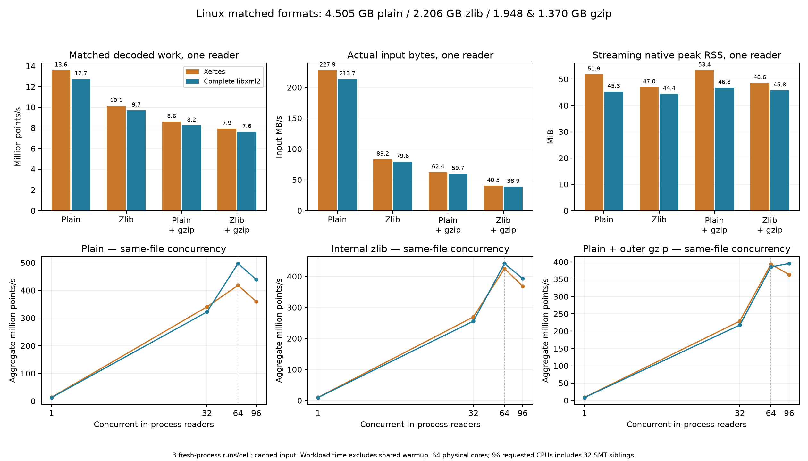
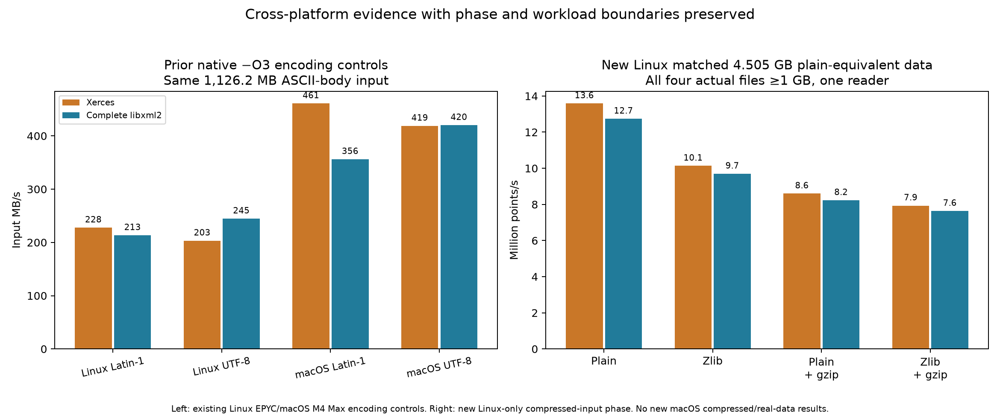

# XML replacement benchmark handoff

The user-requested reduced Linux phase contains **600 workload runs / 660 native processes**, covering 200 cells with three repetitions each. It compares the complete libxml2 replacement (`8f66b3d9`) with the optimized Xerces control (`58aa3734`), through 96 requested threads. Correctness and final source/input/runtime checks passed. The original schedule was reduced after 412 completed workloads; 279 completed non-selected records remain supplemental evidence. The excluded 28-record pilot is preserved separately.

Four matched files, each larger than 1 GB, represent plain XML, internal zlib, outer gzip and both compression layers. Real inputs cover a public Lumos DDA run, published PASEF without retained mobility, and a real TIMS 600–1200s window with finite per-peak/scalar mobility. The latter uses OpenMS RATIONAL table calibration; it is not a proprietary-SDK equivalence claim.

Paired values below are **Xerces / libxml2**. MB is decimal; RSS MiB is binary. Streaming rates use the C++ workload clock. Each comparison uses the same cached input; unlike formats have different input-byte denominators.

| Input | One reader MB/s, X / L | One reader peak MiB, X / L | 96 readers aggregate million points/s, X / L |
|---|---|---|---|
| Matched plain | 227.9 / 213.7 | 51.9 / 45.3 | 359.9 / 439.4 |
| Matched internal zlib | 83.2 / 79.6 | 47.0 / 44.4 | 368.0 / 392.8 |
| Matched plain + outer gzip | 62.4 / 59.7 | 53.4 / 46.8 | 363.4 / 395.3 |
| Matched zlib + outer gzip | 40.5 / 38.9 | 48.6 / 45.8 | Not selected |
| Real DDA (Lumos) | 118.0 / 123.8 | 44.6 / 40.4 | 84.1 / 208.9 |
| Published PASEF (no IM) | 89.3 / 93.4 | 54.6 / 51.6 | 113.5 / 249.2 |
| Real TIMS IM, 600–1200s | 70.2 / 73.7 | 85.8 / 85.5 | 532.7 / 504.3 |

One-reader libxml2 is about 4–6% slower on matched generated inputs and about 5% faster on these real inputs. At 96 readers its matched throughput is 7–22% higher, DDA/PASEF is about 2.5×/2.2×, while the IM window is about 5% slower. These are descriptive ratios of medians for these inputs, not significance tests or universal parser rankings.

Whole-document RSS is close between backends. Libxml2 has lower indexed random-read peaks on these inputs but higher retained-context/index overhead. These are distinct workloads; neither establishes an across-the-board memory win. Whole-document and multi-reader indexed RSS, plus retained context/index overhead, are measured separately. The context estimate subtracts same-N idle RSS and includes index/allocator state; it is not isolated XML-context size. All settings and ranges are in the [combined table](all-comparisons.csv).

| Input | Whole load peak MiB, X / L | Random-read 96 peak MiB, X / L | Retained context/index MiB per reader at 96, X / L |
|---|---|---|---|
| Matched plain | 4,276.7 / 4,272.0 | 11,915.5 / 8,696.8 | 63.1 / 97.6 |
| Real DDA (Lumos) | 481.2 / 476.5 | 5,612.0 / 3,840.7 | 25.7 / 42.6 |
| Real TIMS IM, 600–1200s | 2,845.0 / 2,863.1 | 2,286.9 / 1,345.5 | 12.1 / 17.7 |

| Single gzip file | Tool | Requested setting | Inflated XML MB/s | Peak RSS MiB |
|---|---|---|---|---|
| Matched plain + outer gzip | gzip | 1 | 183.1 | 1.7 |
| Matched plain + outer gzip | pigz | 96 | 343.4 | 2.3 |
| Matched plain + outer gzip | rapidgzip | 96 | 4,444.3 | 3,941.3 |
| Matched zlib + outer gzip | gzip | 1 | 166.9 | 1.7 |
| Matched zlib + outer gzip | pigz | 96 | 291.3 | 2.2 |
| Matched zlib + outer gzip | rapidgzip | 96 | 3,456.8 | 2,755.0 |

CLI RSS uses max(native-child wait4, sampled child VmHWM); the sampled part is a lower bound. Small tools are near the 1 MiB launch floor, so do not infer sub-MiB precision. Pigz uses an ordinary single inflate stream plus helper threads: `-p96` does not mean 96 parallel decoders. Rapidgzip uses its compiled decoder through a Python entry point; startup/interpreter costs remain included. External decompression followed by OpenMS is measured as sequential RAM-file staging, with the additional 4.505 GB/2.206 GB file footprint reported separately.

Earlier macOS evidence remains a separate phase: native-O3/UTF-8 yielded 420.0 MB/s for libxml2 versus 418.8 MB/s for Xerces on the same ASCII-body control; Latin-1 yielded 356.2 versus 460.8 MB/s. Native builds and actual encoding deserve testing on macOS. The new compressed/real-data/decompression measurements are Linux-only. The Linux 96-CPU set contains 64 physical cores plus 32 SMT siblings; observed thread counts and CPU consumption do not prove useful parallel decoding.

Remaining limits: cold-storage I/O, timed XSD validation, new macOS compressed/real/decompression runs, other acquisitions/IM encodings, exhaustive metadata equivalence and alternative product integration. Whole loads retain an MSExperiment; they do not benchmark a separate DOM API.

[Detailed findings](DETAILS.md) · [Methods and reproduction](reproduce/README.md) · [Phase table](summary.csv) · [Combined table](all-comparisons.csv)
